# 悦芽婴护管理系统设计与实现

## 摘要

随着我国人口政策的调整和人民生活水平的不断提高，母婴护理服务需求日益增长，但传统管理模式仍存在信息分散、流程繁琐、资源调度效率低、沟通不畅等问题，难以满足现代家庭对专业化、标准化、数字化护理服务的需求。同时，母婴护理行业在数字化转型过程中面临着数据安全、隐私保护、服务质量监管等多重挑战，亟需通过信息化手段实现行业的规范化、精细化管理。

本系统采用B/S架构，基于Spring Boot和Vue.js技术栈，构建了涵盖管理员、机构、家长、保姆角色的综合管理平台。主要功能包括：用户认证与权限管理（RBAC和JWT）、婴幼儿信息与护理档案管理、保姆管理与智能排班、护理计划与服务执行、预约与服务管理、数据统计与分析、商城与物资管理（电商平台）、消息通知与互动。系统采用前后端分离架构，前端使用Vue.js配合TDesign和Element Plus，后端采用Spring Boot集成MyBatis-Plus，通过RESTful API交互。

该系统推动母婴护理行业数字化转型，提升护理服务透明度和可追溯性，保障婴幼儿健康安全；智能排班提高资源效率，降低运营成本；预约和反馈机制改善沟通体验，提升满意度；商城模块满足采购需求，开辟新业务点；数据安全设计保护隐私，支持可持续发展。系统提供信息化实践方案，具有重要理论价值和实际应用价值。

**关键词：** 母婴护理；Spring Boot；Vue.js；数字化转型

---

## Abstract

With adjustments to China's population policies and continuous improvements in living standards, demand for maternal and infant care services has grown steadily. However, conventional management approaches still face fragmented information, cumbersome processes, inefficient resource allocation, and poor communication, making it difficult to meet modern families' expectations for professional, standardized, and digital care services. Simultaneously, the maternal and infant care industry faces multiple challenges in its digital transformation journey, including data security, privacy protection, and service quality oversight. There is an urgent need to leverage information technology to achieve standardized and refined industry management.

This system adopts a B/S architecture, built upon the Spring Boot and Vue.js technology stack, to create a comprehensive management platform encompassing roles for administrators, institutions, parents, and caregivers. Key functionalities include: user authentication and permission management (RBAC and JWT), infant information and care record management, nanny management and intelligent scheduling, care plan and service execution, appointment and service management, data statistics and analysis, e-commerce platform for mall and supply management, and message notifications and interaction. The system adopts a frontend-backend separation architecture. The frontend utilizes Vue.js integrated with TDesign and Element Plus, while the backend employs Spring Boot integrated with MyBatis-Plus, communicating via RESTful APIs.

This system drives digital transformation in the maternal and infant care industry, enhancing service transparency and traceability to safeguard infant health and safety. Intelligent scheduling optimizes resource efficiency while reducing operational costs. Appointment and feedback mechanisms improve communication experiences and boost satisfaction. The e-commerce module fulfills procurement needs and opens new business avenues. Data security design protects privacy and supports sustainable development. The system provides an information-based implementation solution with significant theoretical and practical value.

**Keywords:** Maternal and Infant Care; Spring Boot; Vue.js; Digital Transformation

## 引言

在"互联网+护理服务"模式快速发展的背景下，母婴护理服务领域正经历着从传统服务模式向数字化、智能化服务模式转变的重要时期。随着我国人口政策的调整和家庭结构的变化，婴幼儿照护服务需求呈现出快速增长态势，然而传统的护理服务模式在信息管理、资源调配、质量监管等方面存在明显不足，难以适应现代家庭对高质量护理服务的需求。贾格等构建了"互联网+护理服务"母婴护理平台，验证了该模式在提升护理服务质量方面的有效性[1]。赵汝等学者研究了虚拟仿真技术下母婴护理技能人才培养模式，为行业人才培养提供了重要参考[2]。这些研究为本系统的建设提供了重要的理论支撑和实践指导。

当前，国内外学者在母婴护理信息化领域开展了大量研究。国内研究主要集中在"互联网+护理服务"模式的构建与应用，沈敏等学者研究了互联网+护理服务模式下基于行为分阶段转变理论的孕期体重管理对超重孕妇母婴结局的影响[3]，陈慧等学者探讨了"互联网+护理"在产褥期母婴延续照护中的应用研究进展[4]，刘佳怡等构建了孕产育一体化母婴"互联网+护理服务"实施方案[5]。这些研究从不同角度探索了互联网技术在母婴护理服务中的应用路径，为构建综合性的护理管理平台积累了宝贵经验。国外研究起步较早，在人工智能技术应用于母婴护理方面已有较为成熟的探索，Sharps等学者研究了人工智能技术在母婴护理中的未来应用前景[6]，为智能化护理服务的发展指明了方向。然而，现有研究多聚焦于单一服务环节或特定应用场景，缺乏涵盖服务全流程、多角色协同的综合管理平台，难以满足现代家庭对一站式、专业化护理服务的迫切需求。

在技术应用层面，基于Spring Boot框架的企业级应用开发已成为主流趋势。Spring Boot框架采用"约定优于配置"的设计理念，大大简化了Spring应用的开发和部署过程，提高了开发效率和系统可维护性。于永利等学者基于Spring Boot设计了药品订购系统，验证了该框架在业务系统开发中的有效性[7]。在数据管理方面，代志涛等研究了基于MySQL与Redis的数据一致性同步与修复方法，为系统数据管理提供了技术参考[8]。这些研究成果为本系统的设计与实现提供了重要的技术支撑，确保了系统在技术架构上的先进性和可靠性。

本研究围绕悦芽婴护管理系统的设计与实现展开，基于Spring Boot与Vue.js构建面向家长、保姆、机构管理员和系统管理员的多角色协同平台。系统集成婴幼儿档案、预约服务、护理记录、智能排班、在线沟通与数据统计等功能，采用前后端分离架构，前端结合Vue.js、TDesign和Element Plus，后端基于Spring Boot与MyBatis-Plus并通过RESTful API完成数据交互。该系统有助于缓解母婴护理服务中资源分散、沟通效率低和过程管理不清晰等问题，为行业的规范化与数字化发展提供实践支撑。

本论文共分为六章，各章内容安排如下。

第一章为系统概述。该章立足母婴护理服务的现实场景，系统阐述课题研究背景、国内外相关研究进展以及Spring Boot、Vue.js等核心技术的选型依据与适用性。

第二章为系统需求分析。该章围绕家长、保姆、机构管理员和系统管理员四类用户角色，梳理预约服务、护理档案管理、智能排班、消息互动等业务需求，并从性能、安全性、可用性等维度明确系统非功能需求。

第三章为系统设计。该章重点给出系统总体架构与模块划分方案，说明前后端分离设计思路、RBAC+JWT权限控制机制、核心业务流程以及MySQL数据库结构设计。

第四章为系统实现。该章结合关键代码与接口流程，详细说明用户认证、婴幼儿信息管理、护理计划执行、预约管理、排班调度及商城物资管理等核心功能的落地实现过程。

第五章为系统测试。该章通过功能测试、接口测试与兼容性测试，对关键业务链路、系统稳定性及运行效果进行验证，并评估系统在实际应用场景中的可行性与有效性。

第六章为结论。该章在前文研究基础上，对悦芽婴护管理系统的建设目标、实现成果与应用价值进行归纳，重点总结多角色协同管理、护理过程可追溯与服务流程规范化等实践成效；同时结合系统运行特征，提出智能推荐、健康数据接入与安全审计强化等后续优化方向。

## 1 系统概述

### 1.1 项目背景

#### 1.1.1 选题背景
随着经济发展与居民生活水平提升，婴幼儿护理服务需求持续增长，"二孩""三孩"政策实施后这一趋势更加明显。以家庭经验和邻里互助为主的传统照护方式，已难以匹配现代家庭对专业化、规范化服务的要求。相关研究表明，年轻父母在系统育儿知识与护理技能方面仍有不足[9]，婴幼儿健康管理对早期发展具有积极作用[10]，护理人员能力评估体系也在不断完善[11]。因此，构建科学、标准的护理管理体系已成为行业发展的现实需求。

当前行业仍存在信息分散、服务标准不一、过程记录不连续和资源分布不均等问题：家长筛选护理人员成本较高，服务质量差异明显，监管与评价机制有待加强，中小城市及农村地区优质服务供给相对不足。

与此同时，云计算、大数据与移动互联网技术的成熟，为行业优化提供了可行路径。通过建设数字化婴幼儿护理管理平台，可在资源调配、流程协同与质量管控方面提升效率和透明度，更好回应家庭对高质量服务的需求。基于此，研发功能完整、操作便捷且安全可靠的管理系统，具有明确的现实意义。

#### 1.1.2 项目目的
本项目的核心目的是构建一套基于Spring Boot技术的悦芽婴护管理系统，通过信息化手段解决传统婴幼儿护理服务中存在的资源分散、沟通不畅、管理混乱等问题。系统旨在为家长、护理人员、护理机构以及平台管理者提供统一的服务平台，实现护理资源的优化配置和高效利用。通过数字化管理手段，系统能够提供标准化的护理流程、专业化的服务指导、实时化的沟通协作以及科学化的数据分析，从而全面提升婴幼儿护理服务的质量和效率。

#### 1.1.3 项目意义
悦芽婴护管理系统兼具理论意义与应用价值，对母婴护理服务数字化转型具有积极作用。
在理论研究方面，本研究将信息系统方法、服务管理思路与母婴护理知识进行融合，形成了面向多角色协同的数字化管理框架。系统遵循软件工程流程并采用面向对象设计，对护理服务流程进行了结构化梳理，为后续标准化建设提供了可参考的实现路径。
就实际应用而言，系统围绕预约、记录、评价与机构管理等关键环节，提升了服务获取效率与过程透明度。家长能够更便捷地匹配护理资源，护理人员与机构可基于平台数据开展协同管理与质量改进。结合相关研究关于多学科协作护理优势的结论[12]，本系统在家长、保姆与机构端的协同机制上进行了有效落地。
从行业与公共价值来看，平台应用有助于推动行业规范化发展，提升中小城市及部分服务薄弱地区的资源可及性。系统沉淀的数据也可为行业治理与政策研判提供参考，同时在服务设计中融入人文关怀理念[13]，有助于提升科学育儿与持续照护水平。
在经济效益层面，系统可降低服务交易与管理成本，提升机构运营效率与资源配置水平，并在一定程度上带动就业与相关产业协同发展，体现出较好的综合效益。

### 1.2 国内外现状

#### 1.2.1 国内发展现状
近年来，国内婴幼儿护理服务在政策与市场双重推动下进入提质升级阶段。自《关于促进3岁以下婴幼儿照护服务发展的指导意见》发布以来，行业在社会参与、服务供给和规范建设方面持续推进；《托育机构保育指导大纲（试行）》也进一步明确了托育服务的操作要求与质量边界。整体上看，行业已从“补供给”逐步转向“提质量、强协同”的发展路径。

在研究和实践层面，国内“互联网+护理服务”探索持续推进。赵喜蝶等从母婴用餐行为出发开展家具研究，为家庭照护环境优化提供了思路[14]；沐宇等基于微信群开展居家用药咨询，验证了线上连续服务的可行性[15]；虞祺琪等对产褥期母婴护理知识掌握情况进行分析，为平台功能边界设定提供了依据[16]；吴雅萍等关于移动护理信息系统在母乳闭环管理中的研究，也为移动端流程设计提供了参考[17]。从市场看，月嫂、托育、家政与互联网平台并行发展，服务供给明显增加，但平台间协同仍不足。当前主要短板集中在服务链条割裂、标准不统一、数据安全机制薄弱与区域发展不平衡等方面。尤其在中小城市和农村地区，优质服务可及性仍偏低。总体而言，国内已形成较好的数字化基础，但在跨主体协同、质量治理和智能化能力上仍有较大提升空间，这也是本系统重点回应的问题。

#### 1.2.2 国外发展现状
相较于国内，国外婴幼儿护理服务数字化起步更早，已形成“平台服务+制度保障+技术支撑”并行的发展模式。美国在商业平台建设方面较为突出，BabyCenter围绕孕期到婴幼儿阶段提供健康跟踪、专家问答与社区互动等服务，强调基于数据的个性化推送；Care.com通过背景调查与用户评价机制强化服务可信度；Kinsa将智能体温监测与健康预警结合，提升了家庭场景下的连续健康管理能力。

欧洲尤其是北欧更强调公共服务协同。芬兰Kela整合医疗、教育和社会服务资源，瑞典1177提供全天候健康咨询，英国NHS相关应用支持疫苗提醒、健康检查和发育评估，体现了“公共平台统筹+家庭端便捷使用”的特征。亚洲方面，日本电子化母子健康手册强化了成长数据连续记录，新加坡HealthHub推进跨机构数据联动。技术上，国外更注重AI、物联网和云计算在真实场景中的结合：算法用于风险识别与个性化建议，设备用于连续监测，云架构支撑稳定服务。Dwivedi等开发的面向基层接生员的交互式移动应用，也为母婴护理移动化实践提供了参考[18]。在治理层面，GDPR与HIPAA等规则对数据收集、使用和授权提出明确要求，美国相关项目资格审查机制进一步强化了服务规范性[19]。总体来看，国外经验的关键在于技术应用、服务流程与制度监管同步推进，对我国平台建设具有现实借鉴意义。

#### 1.2.3 发展趋势分析
从国内外实践来看，婴幼儿护理服务数字化的方向已经比较清晰。服务内容不再停留在信息展示，而是逐步覆盖预约、执行、反馈等完整环节。人工智能、物联网等技术开始在实际业务中发挥作用。线上平台与线下机构协同服务也越来越常见。与此同时，监管制度和法律规则持续完善，行业正朝着更规范、更可持续的方向发展。

### 1.3 相关技术

#### 1.3.1 Java编程语言
Java是成熟的面向对象编程语言，具备跨平台、生态完善和工程化能力强等特点，长期用于企业级系统开发。其核心优势在于封装、继承和多态带来的良好可维护性，同时通过JVM实现“一次编写，多端运行”。在稳定性方面，Java拥有完善的异常机制、自动内存回收和丰富标准库，能够支撑复杂业务场景下的持续迭代与性能优化。

在本系统中，Java主要承担后端业务实现与接口服务。围绕用户、机构、预约、护理记录、订单等核心对象，系统采用分层与模块化设计组织代码，提升功能扩展与维护效率。结合Lambda与Stream等特性，常见数据处理逻辑更简洁；通过统一异常处理与日志记录机制，保障接口调用的可观测性与可排查性，从而满足多角色并发访问下的稳定运行需求。

#### 1.3.2 Vue框架
Vue是轻量且易扩展的前端框架，强调响应式数据驱动和组件化开发，适合构建交互复杂的单页应用。其核心思路是将界面拆分为可复用组件，通过虚拟DOM与依赖追踪实现高效更新，并配合路由与状态管理完成页面协同。相较传统页面开发，Vue在结构清晰度、开发效率和后期维护成本方面具有明显优势。

在本系统中，Vue负责家长端、保姆端和管理端界面的统一构建。系统基于组件化方式封装列表、表单、详情与统计模块，减少重复开发；通过路由守卫与角色路由表控制访问权限，保证不同身份只进入授权页面；借助集中式状态管理维护登录信息与全局数据，提升页面间数据同步效率，使预约、护理记录、消息交互等流程具有更好的连贯性和操作体验。

#### 1.3.3 Spring Boot框架
Spring Boot是在Spring生态上发展起来的快速开发框架，核心理念是“约定优于配置”。通过自动配置与Starter依赖，它显著减少了样板代码和繁琐配置，便于团队快速搭建可运行的服务。该框架内置Web容器与完善的扩展机制，支持分层架构、统一接口规范和生产级监控能力，适合业务模块较多、迭代频繁的管理系统场景。

在本系统中，Spring Boot作为后端主框架，负责接口发布、业务编排与安全控制。系统通过REST风格接口对接前端页面，围绕用户认证、预约管理、护理计划、消息与商城等模块组织服务能力；结合权限控制机制实现不同角色的数据隔离与操作授权；借助配置管理与监控能力，提升部署效率和运行稳定性，为系统后续扩展提供统一的技术底座。

#### 1.3.4 MySQL数据库
MySQL是应用广泛的关系型数据库，具备开源、稳定和易运维等特点，在中大型Web系统中有成熟实践。它支持事务一致性、索引优化与多表关联查询，能够兼顾数据可靠性与读写效率。随着版本演进，MySQL在复杂查询、JSON处理和性能调优方面持续增强。相关研究也表明，MySQL在医疗信息系统等场景中具备良好应用价值[20]。

在本系统中，MySQL承担核心业务数据存储任务，覆盖用户、婴幼儿档案、预约订单、护理计划、护理记录和商品订单等关键实体。数据库设计遵循规范化原则，减少冗余并保证主外键关联完整性；结合事务机制保障预约与记录写入的一致性；通过索引与分页查询优化常用接口性能。配合定期备份与权限控制策略，系统在数据安全性与可恢复性方面具备稳定支撑能力。

### 1.4 本章小结
本章主要完成了研究起点与技术基础的说明。首先，结合母婴护理行业现状梳理了课题背景，明确了系统建设的现实需求；其次，对国内外相关实践进行对比，提炼出当前数字化服务的发展重点与可借鉴经验；最后，围绕Java、Spring Boot、Vue和MySQL等技术给出选型依据，说明其与系统业务场景的匹配关系。上述分析为后续需求拆解、架构设计与功能实现奠定了基础。

## 2 系统需求分析

### 2.1 可行性分析
为评估悦芽婴护管理系统的落地条件，本节从技术、经济与社会三个维度开展可行性分析。其中，社会维度同时纳入用户接受度、运营可实施性与合规要求，用于判断系统在真实应用环境中的可推广性。

#### 2.1.1 技术可行性
本系统采用Spring Boot、Vue 3与MySQL组成的主流技术栈，技术成熟度高、社区资源丰富，能够有效降低开发风险。后端基于Spring Boot快速构建REST接口，前端通过组件化方式提升页面开发效率，MySQL提供稳定的数据存储与事务保障。系统同时引入JWT鉴权、Redis缓存与MyBatis-Plus，兼顾安全性、访问性能与开发效率。结合前后端分离架构，系统在功能扩展、版本迭代和后期维护方面具备较好的可持续性，因此技术落地条件充分。

#### 2.1.2 经济可行性分析
从投入与产出角度看，系统具备较好的经济可行性。项目采用开源技术框架，能够有效控制研发与运维成本，降低初期建设门槛。业务上线后，可通过预约流程规范化、信息协同和数据沉淀，减少机构在人力沟通、排班管理和服务跟进中的时间消耗，从而提升运营效率。对家长端而言，线上筛选、预约与评价机制可降低服务匹配成本；对机构端而言，标准化管理有助于提升服务复购与口碑传播。考虑到系统具备模块化扩展能力，后续可根据业务增长逐步迭代新功能，整体投资回报具有持续性。

#### 2.1.3 社会可行性分析
在社会应用层面，母婴护理服务的数字化需求持续增长，用户对线上预约、过程记录和即时沟通的接受度较高，为系统推广提供了现实基础。本系统围绕家长、保姆、机构管理员和系统管理员四类角色进行功能划分，界面交互与业务流程相对清晰，能够降低使用门槛并提升协同效率。同时，系统在设计阶段同步考虑合规要求，遵循《网络安全法》《数据安全法》《个人信息保护法》《婴幼儿照护服务管理办法》及《消费者权益保护法》等相关规范，通过权限控制、数据加密、日志留痕和记录可追溯机制保障信息安全与服务合规。综合来看，该系统在用户接受度、组织实施性与法规适配性方面均具备较好的社会可行性。

### 2.2 功能需求分析
悦芽婴护管理系统面向家长、保姆、机构管理员和系统管理员四类用户，采用B/S架构并基于Spring Boot与Vue.js实现前后端协同。功能设计围绕“预约-执行-记录-反馈-运营”主链路展开，覆盖婴幼儿档案、护理计划、服务预约、护理记录、在线商城与数据统计等核心环节。整体流程由家长发起服务需求，经机构审核派单后由保姆执行护理并提交记录，家长再进行查看与评价，相关业务数据同步沉淀到平台端用于统计与管理，最终形成可追踪、可复盘的服务闭环。

#### 2.2.1 家长端功能
家长是平台的核心使用者，其需求主要集中在信息维护、服务预约、过程跟踪和评价反馈等环节。为提升操作连贯性，家长端按业务流程划分为以下功能模块。家长端功能用例图如图2.1所示。

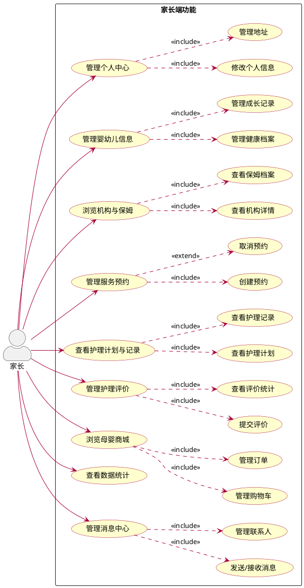

图2.1 家长功能用例图
（1）管理个人中心
家长用户可以在个人中心维护基本信息，包括真实姓名、联系电话、电子邮箱等。系统提供头像上传功能，支持修改登录密码保障账号安全。地址管理功能允许家长添加、编辑、删除多个服务地址，并设置默认地址，便于预约服务时快速选择。
（2）管理婴幼儿信息
家长需要在系统中录入婴幼儿的完整信息，包括姓名、性别、出生日期、血型等基础信息，并详细填写过敏史、既往病史、特殊注意事项等健康信息。系统支持为每个婴幼儿上传头像，建立电子健康档案。健康档案管理功能支持记录婴幼儿的体温、体重、身高等健康指标，系统以图表形式展示健康数据的变化趋势，支持按日期范围查询历史数据，并提供最新健康记录的快速查看。成长记录功能支持记录婴幼儿的饮食、睡眠、排便、活动等日常成长数据，系统以时间线形式展示成长历程，支持上传成长照片，直观记录婴幼儿的成长过程。
（3）浏览机构与保姆
家长可以搜索和浏览系统中的护理机构，查看机构详情信息，包括机构名称、联系方式、地址、服务介绍、员工数量和服务订单量等。系统支持查看机构下属的保姆列表，家长可以查看保姆的详细档案，包括照片、个人简介、从业经历、资格证书、服务评价和评分统计等信息，为选择合适的护理人员提供参考。
（4）管理服务预约
家长可以在线创建预约，选择机构、保姆、服务时间，填写服务地址和特殊需求。系统提供可预约时间段查询功能，根据保姆排班自动显示可用时间。预约列表功能支持查看不同状态的预约，包括待确认、已确认、进行中、已完成、已取消等状态。家长可以查看预约详情，并在服务开始前取消预约。
（5）查看护理计划与记录
机构为婴幼儿制定的护理计划会同步到家长端，家长可以查看详细的护理计划内容，包括计划名称、计划内容、开始和结束日期、执行状态等。家长可以实时查看保姆记录的婴幼儿护理记录，按婴幼儿或护理计划维度查询护理数据，了解婴幼儿的护理情况。
（6）管理护理评价
家长可以对护理服务进行评价，评价内容包括评分和文字评价。系统支持查看我的评价列表，可以修改或删除已提交的评价。在提交评价前，系统会自动检查该护理计划是否已评价，避免重复评价。家长还可以查看指定保姆的所有评价和评分统计数据，作为选择保姆的参考依据。
（7）浏览母婴商城
系统提供在线商城功能，家长可以浏览商品分类、搜索商品、查看商品详情，包括商品名称、价格、库存、商品图片等信息。系统支持推荐商品展示功能。购物车功能支持添加商品、修改数量、删除商品、批量删除、清空购物车、商品选中状态切换和全选操作。订单管理功能支持从购物车创建订单，填写收货信息和备注，支持在线支付（微信、支付宝、余额）、查看订单列表和详情、取消订单、确认收货等操作，系统还提供订单统计功能。
（8）查看数据统计
系统为家长提供数据中心功能，展示婴幼儿数据统计和护理数据统计信息，帮助家长全面了解婴幼儿的护理情况和服务使用情况。同时提供订单历史记录查询功能，支持分页查询历史订单数据。
（9）管理消息中心
家长可以通过消息中心与保姆和机构进行在线沟通，支持发送和接收消息，查看对话记录。系统提供联系人列表功能，展示与家长有业务关系的机构和保姆。消息中心支持未读消息计数、标记已读、批量标记已读、标记全部已读、删除消息等功能，确保家长能够及时获取重要信息。

#### 2.2.2 保姆端功能
保姆作为服务直接执行方，重点关注排班协同、计划执行、服务留痕和沟通反馈等任务。系统据此为保姆端配置以下功能模块。保姆端功能用例图如图2.2所示。

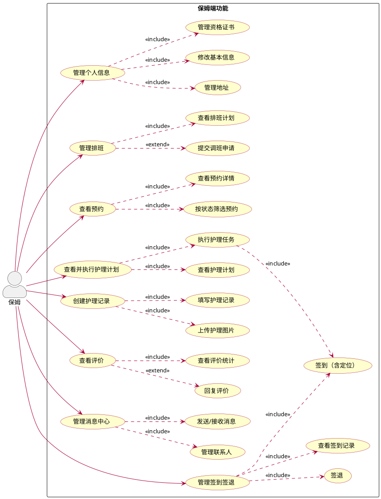

图2.2 保姆功能用例图
（1）管理个人信息
保姆可以在个人中心完善个人信息，包括真实姓名、照片、联系方式等基础信息。系统支持修改登录密码保障账号安全。资格证书管理功能支持保姆上传、查看和删除职业证书，证书信息将展示在保姆档案中供机构审核和家长查看。地址管理功能支持保姆维护个人地址信息，包括添加、编辑、删除地址和设置默认地址。
（2）管理排班
保姆可以查看个人排班计划，系统展示排班信息，包括排班日期、班次类型、工作时间、服务地点等。调班申请功能支持保姆之间协商调换班次，系统展示同机构可调班的保姆列表，保姆提交调班申请后等待机构审批。
（3）查看预约
保姆可以查看分配给自己的预约信息，包括预约日期、服务对象、服务地址、特殊需求等。系统支持按状态筛选预约，包括待确认、已确认、进行中、已完成、已取消等不同状态，帮助保姆合理安排工作。保姆可以查看预约详情，了解服务的具体要求。
（4）管理签到签退
保姆通过签到签退功能记录服务的开始和结束时间，签到信息包括经纬度定位、地址信息和备注。系统支持查看预约的签到记录列表，查看今日签到状态，以及获取签到记录详情，确保服务过程的可追溯性。
（5）查看并执行护理计划
保姆可以查看机构为婴幼儿制定的护理计划，包括计划名称、计划内容、执行状态等。系统支持按状态筛选护理计划，包括待执行、进行中、已完成、已取消等。护理任务执行功能要求保姆在签到状态下才能执行护理计划，系统会验证保姆的签到状态。
（6）创建护理记录
保姆需要详细记录婴幼儿的护理过程，系统支持创建不同类型的护理记录，包括喂养、洗护、哄睡、早教、其他等。护理记录创建功能要求保姆填写护理类型、护理内容、上传护理图片并添加备注信息，确保护理过程的完整记录。系统支持修改和删除护理记录，查看今日护理记录和历史护理记录。
（7）查看评价
保姆可以查看家长对自己的服务评价，包括评分、评价内容、评价时间等，帮助保姆了解自己的服务质量和改进方向。系统展示评价统计数据，包括平均评分、各分数段占比等。保姆可以对家长的评价进行回复，促进双向沟通。
（8）管理消息中心
保姆可以通过消息中心与家长和所属机构进行在线沟通，支持发送和接收消息，查看对话记录。系统提供联系人列表功能，展示服务过的家长和所属机构。消息中心支持未读消息计数、标记已读、标记全部已读、删除消息等功能，确保保姆能够及时获取重要信息。

#### 2.2.3 机构端功能
机构管理员承担机构运营与服务调度职责，涉及人员管理、计划安排、预约处理和经营统计等工作。系统为机构端设置了以下功能模块。机构管理员端功能用例图如图2.3所示。

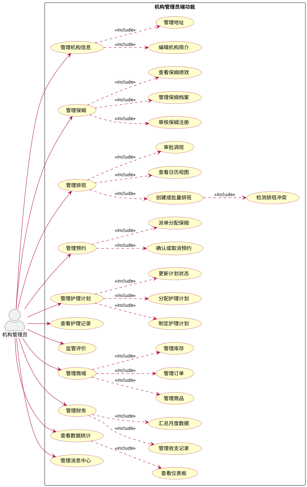

图2.3 机构功能用例图
（1）管理机构信息
机构管理员可以维护机构的基本信息，包括机构名称、法人代表、联系人、联系电话、电子邮箱、详细地址等。机构简介编辑功能允许机构撰写详细的介绍，包括机构规模、服务特色、团队优势等，提升机构形象。地址管理功能支持机构维护服务地址信息。
（2）管理保姆
保姆审核功能用于审核保姆的注册申请，机构管理员可以查看保姆提交的信息，审核通过后保姆才能正常使用系统。保姆列表功能展示机构下所有保姆的信息，支持按状态筛选。保姆档案管理功能提供保姆信息的查看、修改和删除操作。保姆绩效查看功能展示每个保姆的服务数据，帮助机构了解保姆的工作表现。
（3）管理排班
排班计划制定功能支持为保姆创建单个或批量排班记录，机构可以设置排班日期、班次类型和工作时间。日历视图功能按月展示所有保姆的排班情况，直观呈现排班安排。排班列表功能支持按保姆、日期范围等条件查询排班记录，并支持修改和删除排班。调班审批功能用于处理保姆的调班申请，机构管理员选择批准或拒绝。系统提供排班冲突检测功能，在创建排班时自动检查是否存在时间冲突。
（4）管理预约
预约订单管理功能展示所有预约订单，支持按状态、服务类型、日期范围、关键词等条件筛选。机构可以查看预约详情、确认或取消预约，并通过派单功能为预约分配合适的保姆。系统提供预约统计功能，展示各状态预约的数量和趋势数据。
（5）管理护理计划
护理计划制定功能支持机构根据预约信息为婴幼儿创建护理计划，包括计划名称、计划内容、起止日期等信息。系统会自动关联预约对应的婴幼儿和保姆信息。护理计划列表功能支持按状态、婴幼儿、保姆等条件查询。计划分配功能将制定好的护理计划分配给具体的保姆执行。计划状态管理功能支持修改护理计划的执行状态，包括待执行、进行中、已完成和已取消。
（6）查看护理记录
机构管理员可以查看所有保姆的护理记录，支持按保姆、婴幼儿、护理类型等条件筛选。系统支持按护理计划维度和婴幼儿维度查看护理记录详情，帮助机构监督护理服务质量。
（7）监管评价
评价管理功能展示机构下所有保姆收到的服务评价，支持按保姆和评分条件筛选。机构可以查看评价详情和保姆的评分统计数据，包括平均评分、各分数段占比等，帮助机构监督服务质量。
（8）管理商城
商品管理功能支持机构添加、修改、删除商品，包括商品名称、价格、库存、商品图片等信息，支持商品上架和下架操作。订单管理功能展示所有商品订单，支持按状态筛选，机构可以为订单添加物流信息完成发货操作，系统提供订单统计功能。库存管理功能支持记录商品的出入库操作，查看当前库存情况和库存不足商品列表，设置库存预警值，系统在库存低于预警值时自动提醒。
（9）管理财务
财务记录管理功能支持新增收入和支出记录，查看财务记录列表，按日期范围统计收支情况。月度汇总功能按年度展示每月的收入、支出和利润数据。系统提供财务报表导出功能，便于机构进行财务核算。
（10）查看数据统计
仪表板功能提供机构运营数据概览，包括服务数据统计、保姆绩效排名、评价分析和财务数据等。系统支持按不同维度导出报表数据，为机构运营分析和管理决策提供依据。
（11）管理消息中心
消息中心功能支持机构与家长在线沟通，提供联系人管理、消息收发、已读标记等能力，便于机构及时响应服务咨询与业务协同需求。

#### 2.2.4 管理员端功能
系统管理员负责平台级治理与全局运营监督。围绕账号、机构、人员、商品与数据等核心对象，系统管理员端设计了如下功能模块。系统管理员端功能用例图如图2.4所示。

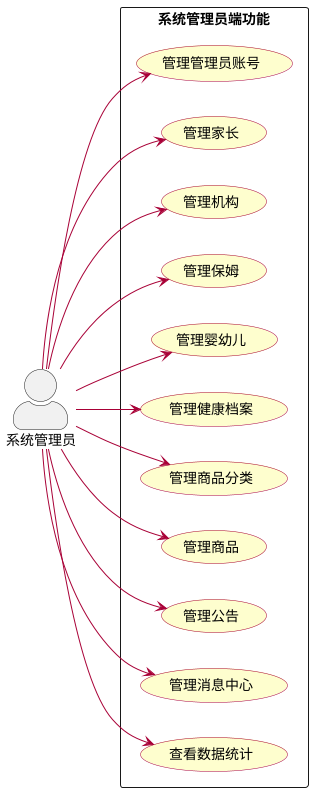

图2.4 管理员功能用例图
（1）管理管理员账号
管理员账号管理功能提供管理员用户的增删改查操作，支持分页查询管理员列表，维护平台管理团队的账号信息。
（2）管理家长
家长管理功能展示所有家长用户信息，支持按用户名、昵称、手机号等关键词搜索，查看家长详情、启用或禁用家长账号、删除家长等操作。管理员可以通过家长管理页面跳转查看该家长名下的婴幼儿信息，实现用户数据的全链路监管。
（3）管理机构
机构管理功能展示所有护理机构信息，支持查看机构详情（包括机构名称、法人代表、联系方式、地址等）、启用或禁用机构、删除机构等操作，对入驻机构进行资质审查和运营监管。
（4）管理保姆
保姆管理功能展示所有保姆信息，支持查看保姆详情、修改保姆状态（在职、离职、待审核等）、删除保姆等操作，对护理人员的从业资质和服务状态进行全面监督。
（5）管理婴幼儿
婴幼儿管理功能支持查看和管理系统中所有婴幼儿的信息，包括姓名、性别、出生日期、血型、过敏信息等。支持按姓名或昵称搜索、按性别筛选，提供婴幼儿信息的编辑和删除操作，确保婴幼儿数据的完整性和准确性。
（6）管理健康档案
健康档案管理功能展示所有婴幼儿的健康记录数据，支持按家长、婴幼儿、记录人类型、日期范围等多维度条件筛选查询。管理员可以查看健康记录详情和健康数据图表，监督数据质量，保障婴幼儿健康信息的规范管理。
（7）管理商品分类
商品分类管理功能支持系统管理员创建、编辑、删除商品分类，维护分类的层级结构（树形结构），支持分类的启用和禁用操作，为商城商品提供规范化的分类体系。
（8）管理商品
商品管理功能提供平台所有商品的查看、修改、删除操作，支持商品上架和下架、批量删除和批量修改状态等操作，对各机构上架的商品进行统一审核和管理。
（9）管理公告
公告管理功能支持系统管理员创建、编辑、删除系统公告，公告内容可以是系统维护通知、政策变更通知、节日祝福等。系统支持公告的发布和下线操作，已发布的公告会展示给所有用户，实现平台信息的统一发布与管理。
（10）管理消息中心
消息中心功能支持管理员与所有角色用户（家长、保姆、机构）进行在线沟通。管理员可以选择不同角色的联系人发送消息，查看对话记录，支持未读消息计数、标记已读、删除消息等操作，确保平台与用户之间的信息传递畅通。
（11）查看数据统计
数据统计功能为管理员提供平台整体运营数据概览，首页仪表板展示用户统计（注册用户总数、各角色用户数量）、机构统计、订单统计（订单总量、各状态订单数量）和收入统计等关键指标。系统支持按时间范围生成订单报表、收入报表和用户报表等多种类型的数据报表，帮助管理员全面了解平台运营状况，为运营决策提供数据支撑。

### 2.3 非功能性需求分析

#### 2.3.1 可用性需求
可用性方面，系统需长期保持稳定运行，目标可用率不低于99.5%，并在故障发生后30分钟内完成核心服务恢复。数据保障采用“每日全量+每小时增量”的备份策略，备份保留周期不少于30天，同时配置异地灾备以支持故障场景下的快速切换。为降低使用门槛，界面设计应保持直观清晰，确保新用户可在5分钟内完成基础操作，并配套操作文档与在线支持渠道。

#### 2.3.2 安全性需求
安全性方面，系统以“身份可信、访问可控、数据可护”为基本原则。登录认证环节需保证口令安全存储，避免明文保存；权限控制采用基于角色的访问策略，确保不同用户仅可访问授权功能与数据范围。对于婴幼儿信息、健康记录等敏感数据，应进行加密存储；网络传输过程统一采用HTTPS，降低数据泄露与中间人攻击风险。

#### 2.3.3 可维护性需求
可维护性方面，系统应遵循统一编码规范与分层设计原则，保证代码结构清晰、职责边界明确。通过模块化组织降低耦合度，便于后续定位问题与独立迭代。研发流程中使用Git进行版本管理并落实分支策略，配套维护系统设计、接口、数据库和部署文档。运行阶段需保留关键日志与异常信息，用于故障排查、性能分析和运维复盘。

#### 2.3.4 可扩展性需求
可扩展性方面，系统需能够适应业务规模增长和功能持续演进。架构设计采用松耦合思路，支持按资源与负载进行水平或垂直扩展；数据层预留读写分离、分库分表等扩容路径，以应对访问量和数据量上升。功能层面应预留清晰的扩展接口，确保新增模块时尽量不影响既有业务稳定性。

#### 2.3.5 兼容性需求
兼容性方面，系统需覆盖常见访问终端与运行环境，保证不同设备上的一致体验。浏览器层面应适配Chrome、Firefox、Edge等主流版本；终端层面支持PC、平板与移动设备，并通过响应式布局适配不同屏幕尺寸。系统应兼容Windows、macOS、iOS、Android等主流操作系统，在常见分辨率下保持界面显示完整、交互正常。

### 2.4 本章小结
本章围绕悦芽婴护管理系统完成了需求层面的系统梳理。可行性分析部分从技术、经济、社会三个维度论证了项目落地条件，其中社会维度已包含用户接受度与合规要求。功能需求部分进一步细化了家长、保姆、机构管理员和系统管理员四类角色的业务边界，并通过用例图呈现主要交互关系。非功能需求部分从可用性、安全性、可维护性、可扩展性与兼容性等方面提出约束，为后续系统设计提供了明确依据。

## 3 系统设计

### 3.1 系统总体设计

#### 3.1.1 系统功能设计

本系统以母婴护理服务全流程为主线进行功能拆分，并按家长、保姆、机构管理员、系统管理员四类角色配置差异化能力。家长端重点支持婴幼儿档案维护、服务预约、护理记录查看、评价反馈及商城下单；保姆端聚焦排班协同、签到签退、护理计划执行与服务留痕；机构管理员端主要负责人员管理、预约派单、护理计划安排、商品库存与财务统计等运营事项；系统管理员端则承担平台级治理任务，包括用户与机构监管、公告发布、分类与商品审核、报表分析及运维管理。

系统功能模块图如图3.1所示。

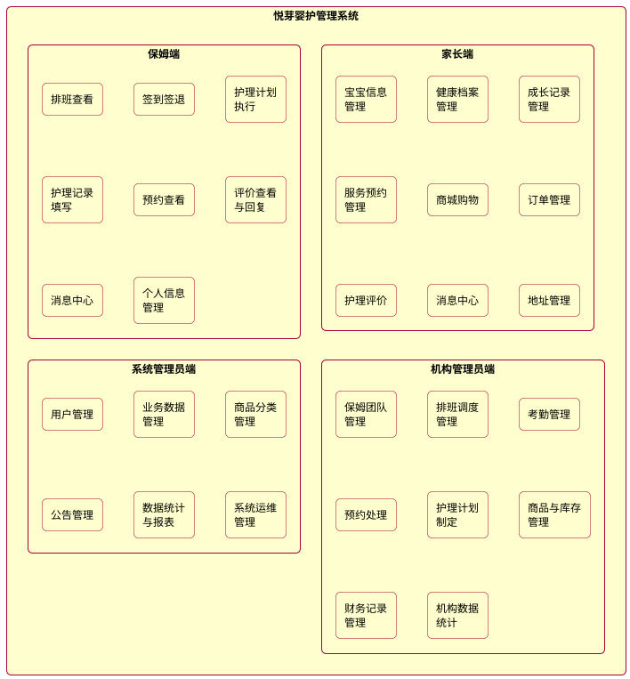

图3.1 系统功能模块图

#### 3.1.2 系统架构设计

本系统采用B/S与前后端分离架构，整体由表现层、控制层、业务逻辑层、数据访问层、中间件层和数据库层组成：表现层基于Vue.js按家长、保姆、机构管理员和系统管理员四类角色构建界面，其中家长端与保姆端使用TDesign，机构端与管理员端使用Element Plus，并通过携带JWT的RESTful请求与后端通信；控制层依托Spring Boot Controller完成请求路由、参数校验和统一响应封装，结合JWT拦截、日志拦截、跨域配置与Knife4j文档保障接口治理；业务逻辑层由Service模块承载认证、预约、订单等核心规则，采用接口与实现分离以降低耦合；数据访问层基于MyBatis-Plus通过Mapper完成对象与表结构映射，借助通用CRUD、条件构造与分页能力提升开发效率；中间件层使用Redis处理令牌会话与热点数据缓存，以减少数据库压力并提升响应性能；数据库层采用MySQL持久化用户、预约、订单、考勤等结构化数据，表设计遵循第三范式并通过关联约束保障数据一致性与完整性。

系统架构图如图3.2所示。

图3.2 系统架构图

### 3.2 详细功能设计

在第二章需求分析的基础上，本节进一步细化系统关键功能的执行过程，重点说明各角色在业务流转中的职责分工，并通过时序图展示前端、后端服务与数据层之间的交互关系。

#### 3.2.1 家长端功能设计

（1）服务预约功能设计

服务预约从家长提交申请开始：家长在前端填齐机构、婴幼儿、服务类型与时段后发起请求，后台生成单号、完成时间冲突检查并写入待确认记录。

家长发起预约时序图如图3.3所示。

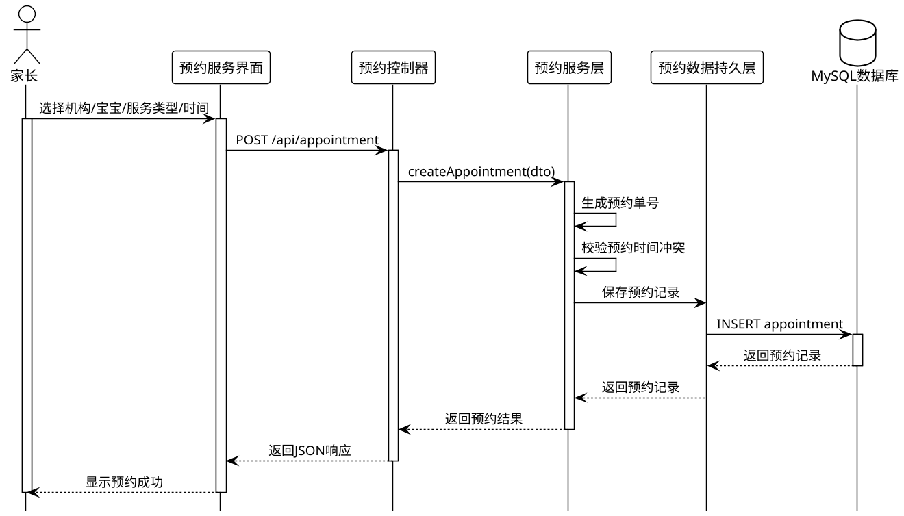

图3.3 家长发起预约时序图

机构管理员在管理端查看待确认预约列表，并对预约执行确认或状态更新。

机构处理预约时序图如图3.4所示。

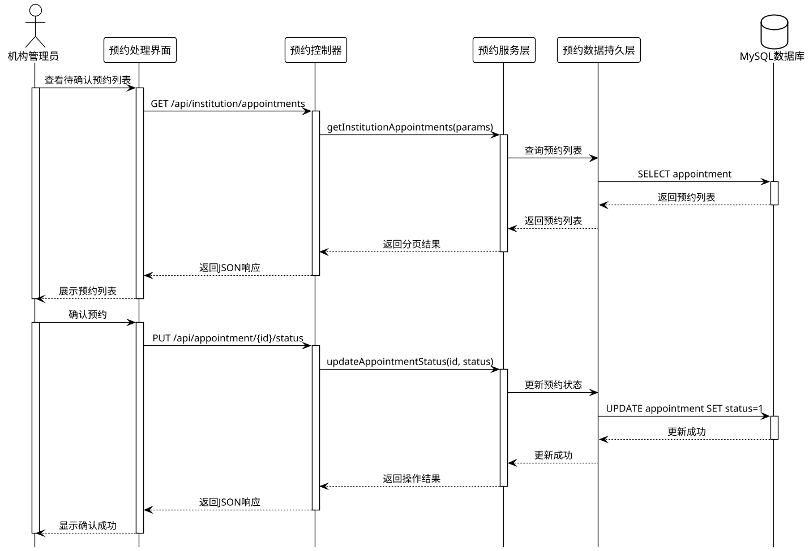

图3.4 机构处理预约时序图

（2）商城购物功能设计

商城购物功能覆盖商品浏览、购物车操作与订单提交三个关键环节。家长在前端选择商品后，系统先写入购物车数据；提交订单时，后端基于已选商品生成订单主记录与明细记录，完成金额计算并同步扣减库存，保证交易数据与库存数据一致。

商城购物时序图如图3.5所示。

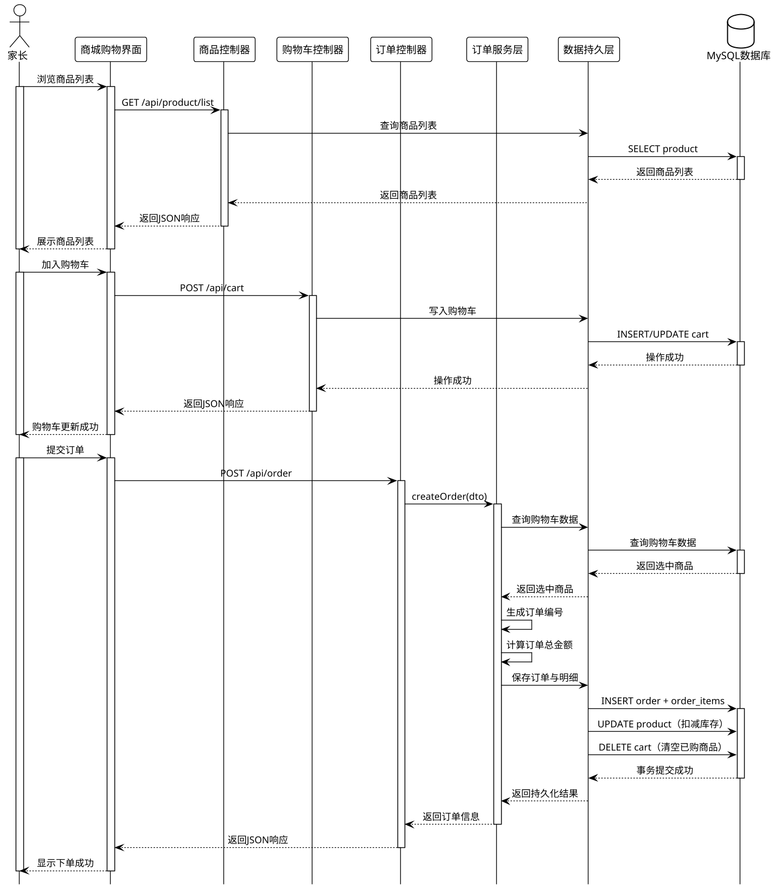

图3.5 商城购物时序图

#### 3.2.2 保姆端功能设计

（1）护理记录创建功能设计

护理记录用于留存保姆执行服务的全过程，是保障可追溯管理的重要数据来源。保姆在关联护理计划后填写护理类型、记录内容与备注，并可上传图片作为佐证；系统完成身份与权限校验后将记录持久化。家长端可查看对应记录，从而提升服务过程透明度。

护理记录创建时序图如图3.6所示。

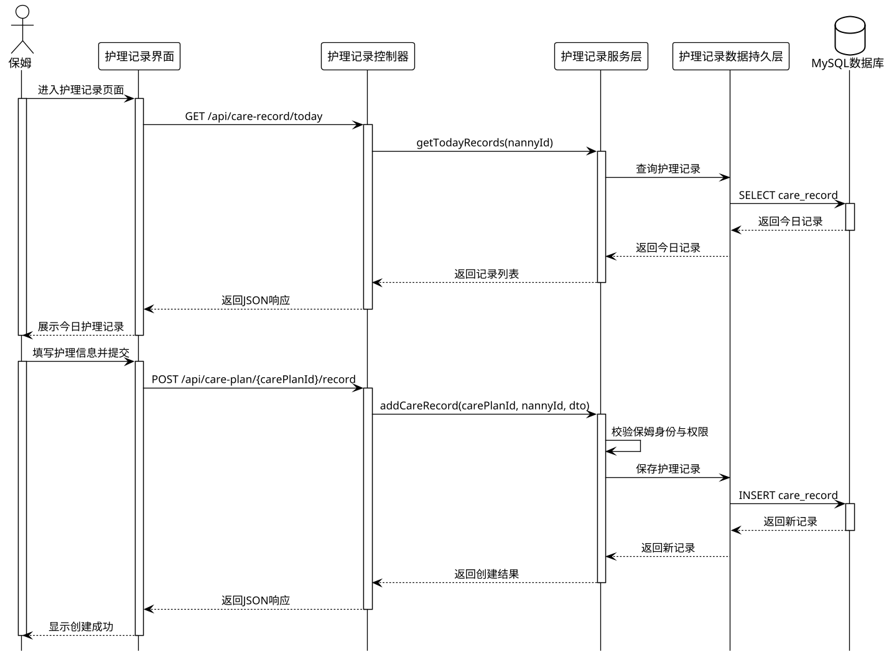

图3.6 护理记录创建时序图

（2）签到签退功能设计

签到签退功能用于标记服务起止节点，并形成可核验的过程数据。保姆到达服务地点后执行签到，系统记录时间、经纬度与地址信息，并校验是否处于有效范围；服务结束后执行签退，系统再次记录位置信息并计算服务时长。签到与签退分别由独立接口处理，便于审计和异常排查。

签到签退时序图如图3.7所示。

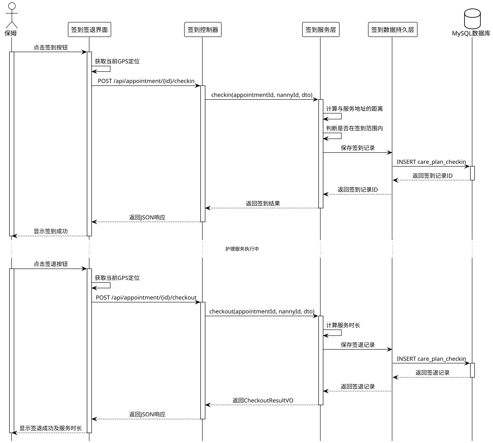

图3.7 签到签退时序图

#### 3.2.3 机构管理员端功能设计

（1）排班调度功能设计

排班调度包括机构管理员维护排班计划，以及保姆发起调班并由机构审批。

排班创建时序图如图3.8所示。

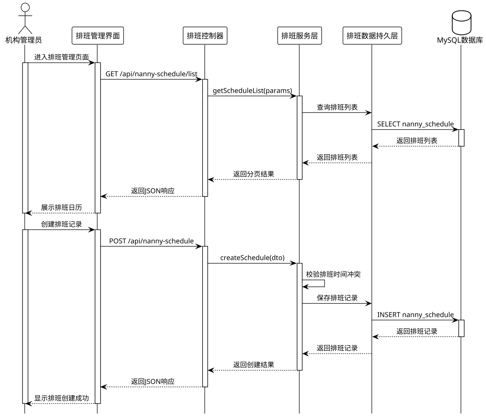

图3.8 排班创建时序图

保姆提交调班申请后，机构管理员在管理端完成审批并回写排班数据。

调班审批时序图如图3.9所示。

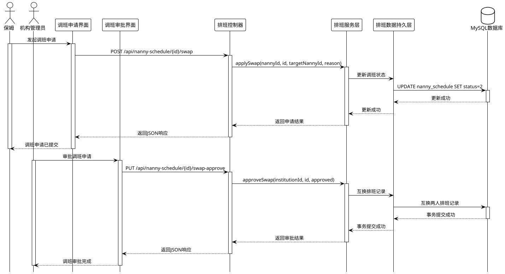

图3.9 调班审批时序图

（2）护理计划制定功能设计

护理计划把预约落实为可执行的任务单元，写明服务对象、时段、要点与责任保姆；机构端完成计划创建与指派。

机构护理计划维护时序图如图3.10所示。

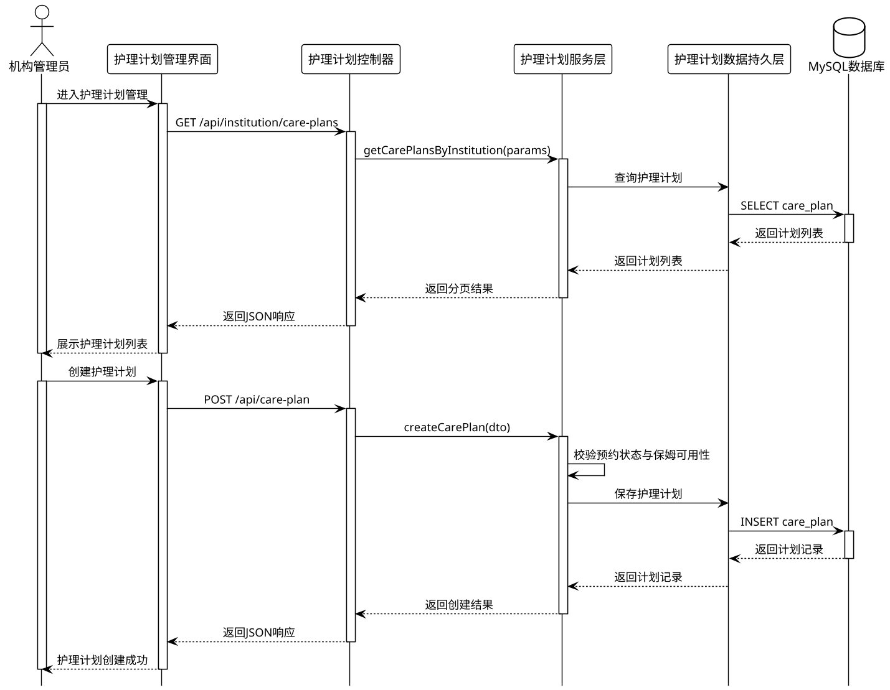

图3.10 机构护理计划维护时序图

保姆按计划拉取待办任务并回写执行状态。

保姆护理计划执行时序图如图3.11所示。

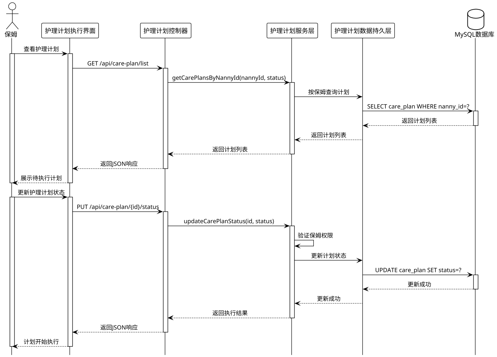

图3.11 保姆护理计划执行时序图

#### 3.2.4 系统管理员端功能设计

（1）用户管理功能设计

用户管理功能用于系统管理员统一维护平台账户，覆盖管理员、家长、保姆和机构四类角色。管理员可执行列表查询、状态调整、详情查看与删除等操作。为提升查询性能，系统对用户列表进行Redis缓存，并在增删改后自动清理相关缓存，保证数据一致性。

用户管理时序图如图3.12所示。

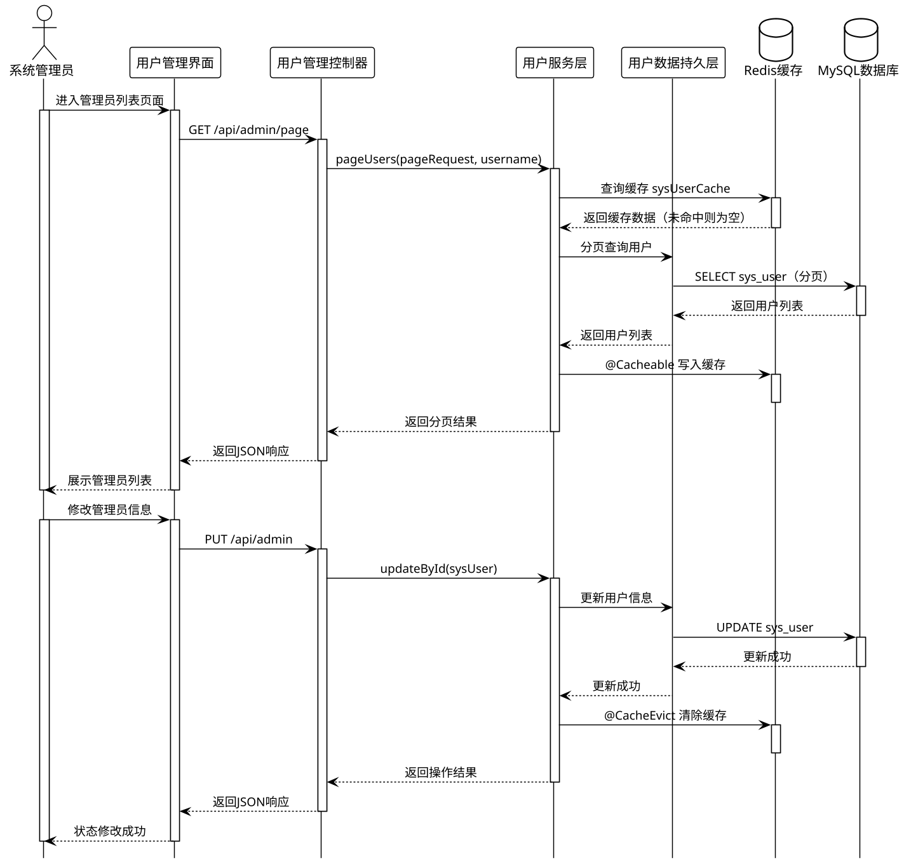

图3.12 用户管理时序图

（2）数据统计与报表功能设计

数据统计与报表功能包括仪表板查询与报表导出；仪表板侧汇总关键指标并支撑图表展示。

仪表板统计时序图如图3.13所示。

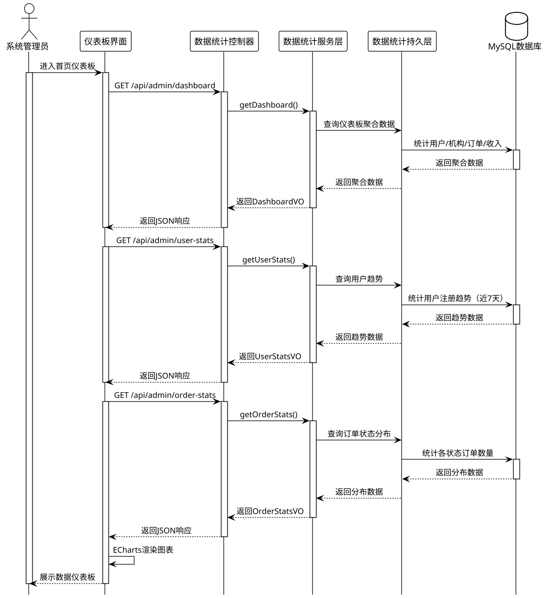

图3.13 仪表板统计时序图

报表导出按条件查询业务数据并生成可下载文件。

报表导出时序图如图3.14所示。

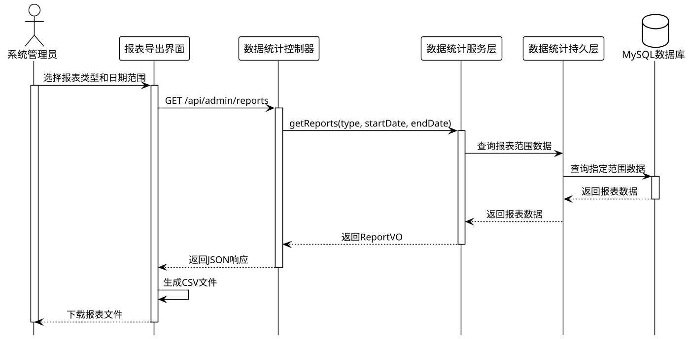

图3.14 报表导出时序图

### 3.3 数据库设计

#### 3.3.1 数据库概念设计

数据库概念设计是在需求分析的基础上，运用实体-关系模型（E-R模型）对系统中的数据对象及其相互关系进行抽象描述。本系统的数据实体主要围绕用户角色、婴幼儿管理、护理服务和商城交易四大业务领域展开。用户域包含系统管理员、家长、保姆和机构四类实体；婴幼儿域涵盖宝宝基本信息、健康档案和成长记录三类实体；护理服务域包括预约、护理计划、护理记录、签到记录和护理评价五类实体；商城交易域包含商品分类、商品、购物车、订单和订单明细五类实体。此外，系统还包括排班、考勤、地址、消息、公告、财务记录和库存等辅助管理实体。各实体之间通过外键建立关联关系，形成完整的数据模型。

系统总体E-R图如图3.15所示。

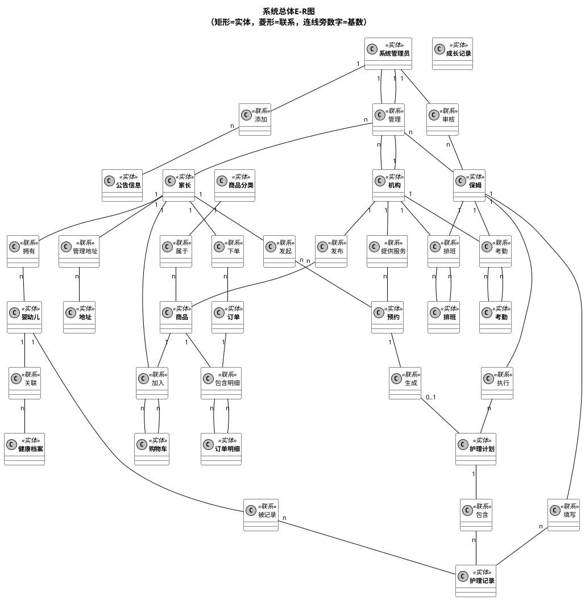

图3.15 系统总体E-R图

#### 3.3.2 数据库逻辑设计

在概念设计的基础上，将E-R模型转化为关系数据库的逻辑结构，即具体的数据库表设计。本系统共设计了24张数据表，涵盖用户管理、婴幼儿管理、护理服务、商城交易和系统管理五大模块。所有表均采用自增主键，通过外键字段建立表间关联关系，使用deleted字段实现逻辑删除，create_time和update_time字段自动记录数据操作时间。以下对核心业务表进行详细说明。

（1）系统管理员表（sys_user）

系统管理员表存储平台管理人员的账号信息，包括登录凭证和个人资料。密码字段采用MD5加密存储，状态字段控制账号的启用和禁用。如表3.1所示。

表3.1 系统管理员表（sys_user）

| 序号 | 列名 | 数据类型 | 主键 | 空值 | 说明 |
|------|------|----------|------|------|------|
| 1 | id | bigint | Y | N | 主键ID |
| 2 | username | varchar | N | N | 用户名 |
| 3 | password | varchar | N | N | 密码（MD5加密） |
| 4 | nickname | varchar | N | Y | 昵称 |
| 5 | email | varchar | N | Y | 邮箱 |
| 6 | phone | varchar | N | N | 手机号 |
| 7 | avatar | varchar | N | Y | 头像URL |
| 8 | status | boolean | N | N | 状态（0-禁用，1-正常） |
| 9 | create_time | datetime | N | N | 创建时间 |
| 10 | update_time | datetime | N | N | 更新时间 |
| 11 | deleted | boolean | N | N | 删除标志 |

（2）家长表（parent）

家长表记录家长用户的基本个人信息，包含身份证号用于实名认证。家长通过该账号管理宝宝信息、预约服务和商城购物。如表3.2所示。

表3.2 家长表（parent）

| 序号 | 列名 | 数据类型 | 主键 | 空值 | 说明 |
|------|------|----------|------|------|------|
| 1 | id | bigint | Y | N | 主键ID |
| 2 | username | varchar | N | N | 用户名 |
| 3 | password | varchar | N | N | 密码（MD5加密） |
| 4 | real_name | varchar | N | Y | 真实姓名 |
| 5 | phone | varchar | N | N | 手机号 |
| 6 | email | varchar | N | Y | 邮箱 |
| 7 | avatar | varchar | N | Y | 头像URL |
| 8 | gender | tinyint | N | N | 性别（0-未知，1-男，2-女） |
| 9 | id_card | varchar | N | Y | 身份证号 |
| 10 | status | tinyint | N | N | 状态（0-禁用，1-正常） |
| 11 | create_time | datetime | N | N | 创建时间 |
| 12 | update_time | datetime | N | N | 更新时间 |
| 13 | deleted | tinyint | N | N | 删除标志 |

（3）婴幼儿信息表（baby）

婴幼儿信息表存储宝宝的基本资料，通过parent_id与家长表建立一对多关联。血型和过敏信息为护理服务提供重要参考。如表3.3所示。

表3.3 婴幼儿信息表（baby）

| 序号 | 列名 | 数据类型 | 主键 | 空值 | 说明 |
|------|------|----------|------|------|------|
| 1 | id | bigint | Y | N | 主键ID |
| 2 | parent_id | bigint | N | N | 家长ID（外键） |
| 3 | name | varchar | N | N | 宝宝姓名 |
| 4 | nickname | varchar | N | Y | 宝宝昵称 |
| 5 | gender | tinyint | N | N | 性别（0-未知，1-男，2-女） |
| 6 | birth_date | date | N | Y | 出生日期 |
| 7 | avatar | varchar | N | Y | 宝宝头像 |
| 8 | blood_type | varchar | N | Y | 血型 |
| 9 | allergy_info | varchar | N | Y | 过敏信息 |
| 10 | remark | varchar | N | Y | 备注 |
| 11 | create_time | datetime | N | N | 创建时间 |
| 12 | update_time | datetime | N | N | 更新时间 |
| 13 | deleted | tinyint | N | N | 删除标志 |

（4）保姆表（nanny）

保姆表记录护理人员的个人信息和职业资质，通过institution_id与机构表建立多对一关联。证书字段以JSON数组格式存储，支持多张资格证书。如表3.4所示。

表3.4 保姆表（nanny）

| 序号 | 列名 | 数据类型 | 主键 | 空值 | 说明 |
|------|------|----------|------|------|------|
| 1 | id | bigint | Y | N | 主键ID |
| 2 | institution_id | bigint | N | N | 所属机构ID（外键） |
| 3 | username | varchar | N | N | 用户名 |
| 4 | password | varchar | N | N | 密码（MD5加密） |
| 5 | real_name | varchar | N | N | 真实姓名 |
| 6 | phone | varchar | N | N | 手机号 |
| 7 | gender | tinyint | N | N | 性别 |
| 8 | id_card | varchar | N | Y | 身份证号 |
| 9 | birth_date | date | N | Y | 出生日期 |
| 10 | work_years | int | N | Y | 工作年限 |
| 11 | certificate | varchar | N | Y | 资格证书（JSON数组） |
| 12 | introduction | varchar | N | Y | 个人简介 |
| 13 | status | tinyint | N | N | 状态（0-禁用，1-正常） |
| 14 | create_time | datetime | N | N | 创建时间 |
| 15 | update_time | datetime | N | N | 更新时间 |
| 16 | deleted | tinyint | N | N | 删除标志 |

（5）预约表（appointment）

预约表是系统核心业务表之一，记录家长发起的护理服务预约信息。通过外键关联家长、宝宝、机构和保姆四个实体，支持多种服务类型和完整的状态流转。如表3.5所示。

表3.5 预约表（appointment）

| 序号 | 列名 | 数据类型 | 主键 | 空值 | 说明 |
|------|------|----------|------|------|------|
| 1 | id | bigint | Y | N | 主键ID |
| 2 | appointment_no | varchar | N | N | 预约单号 |
| 3 | parent_id | bigint | N | N | 家长ID（外键） |
| 4 | baby_id | bigint | N | N | 宝宝ID（外键） |
| 5 | institution_id | bigint | N | N | 机构ID（外键） |
| 6 | nanny_id | bigint | N | Y | 指定保姆ID（外键） |
| 7 | service_type | tinyint | N | N | 服务类型（1-日常护理，2-月嫂服务，3-育儿指导，4-其他） |
| 8 | appointment_date | date | N | N | 预约日期 |
| 9 | start_time | time | N | N | 开始时间 |
| 10 | end_time | time | N | N | 结束时间 |
| 11 | requirement | varchar | N | Y | 服务需求 |
| 12 | address_id | bigint | N | N | 服务地址ID（外键） |
| 13 | status | tinyint | N | N | 状态（0-待确认，1-已确认，2-进行中，3-已完成，4-已取消） |
| 14 | cancel_reason | varchar | N | Y | 取消原因 |
| 15 | create_time | datetime | N | N | 创建时间 |
| 16 | update_time | datetime | N | N | 更新时间 |
| 17 | deleted | tinyint | N | N | 删除标志 |

（6）护理计划表（care_plan）

护理计划表存储机构为婴幼儿制定的个性化护理方案，关联预约、宝宝和指定保姆，包含计划执行的时间范围和状态追踪。如表3.6所示。

表3.6 护理计划表（care_plan）

| 序号 | 列名 | 数据类型 | 主键 | 空值 | 说明 |
|------|------|----------|------|------|------|
| 1 | id | bigint | Y | N | 主键ID |
| 2 | institution_id | bigint | N | N | 机构ID（外键） |
| 3 | baby_id | bigint | N | N | 宝宝ID（外键） |
| 4 | nanny_id | bigint | N | N | 指定保姆ID（外键） |
| 5 | appointment_id | bigint | N | N | 关联预约ID（外键） |
| 6 | plan_name | varchar | N | N | 计划名称 |
| 7 | plan_content | varchar | N | Y | 计划内容 |
| 8 | start_date | date | N | N | 开始日期 |
| 9 | end_date | date | N | N | 结束日期 |
| 10 | status | tinyint | N | N | 状态（0-待执行，1-进行中，2-已完成，3-已取消） |
| 11 | create_time | datetime | N | N | 创建时间 |
| 12 | update_time | datetime | N | N | 更新时间 |
| 13 | deleted | tinyint | N | N | 删除标志 |

（7）护理记录表（care_record）

护理记录表详细记录保姆的每次护理服务过程，支持多种护理类型分类，关联护理计划和宝宝信息，图片字段以JSON格式存储。如表3.7所示。

表3.7 护理记录表（care_record）

| 序号 | 列名 | 数据类型 | 主键 | 空值 | 说明 |
|------|------|----------|------|------|------|
| 1 | id | bigint | Y | N | 主键ID |
| 2 | care_plan_id | bigint | N | N | 护理计划ID（外键） |
| 3 | baby_id | bigint | N | N | 宝宝ID（外键） |
| 4 | nanny_id | bigint | N | N | 保姆ID（外键） |
| 5 | record_date | date | N | N | 记录日期 |
| 6 | record_time | time | N | N | 记录时间 |
| 7 | care_type | tinyint | N | N | 护理类型（1-喂养，2-洗护，3-哄睡，4-早教，5-其他） |
| 8 | care_content | varchar | N | N | 护理内容 |
| 9 | images | varchar | N | Y | 图片（JSON数组） |
| 10 | remark | varchar | N | Y | 备注 |
| 11 | create_time | datetime | N | N | 创建时间 |
| 12 | update_time | datetime | N | N | 更新时间 |
| 13 | deleted | tinyint | N | N | 删除标志 |

（8）婴幼儿健康档案表（baby_health_record）

健康档案表记录婴幼儿的体检和健康数据，涵盖身高、体重、头围、体温等生长发育指标，以及疫苗接种和疾病记录等医疗信息。如表3.8所示。

表3.8 婴幼儿健康档案表（baby_health_record）

| 序号 | 列名 | 数据类型 | 主键 | 空值 | 说明 |
|------|------|----------|------|------|------|
| 1 | id | bigint | Y | N | 主键ID |
| 2 | baby_id | bigint | N | N | 宝宝ID（外键） |
| 3 | record_date | date | N | N | 记录日期 |
| 4 | height | decimal | N | Y | 身高（cm） |
| 5 | weight | decimal | N | Y | 体重（kg） |
| 6 | head_circumference | decimal | N | Y | 头围（cm） |
| 7 | temperature | decimal | N | Y | 体温（℃） |
| 8 | health_status | varchar | N | Y | 健康状况 |
| 9 | vaccination | varchar | N | Y | 疫苗接种情况 |
| 10 | illness_record | varchar | N | Y | 疾病记录 |
| 11 | recorder_type | tinyint | N | N | 记录人类型（1-家长，2-保姆） |
| 12 | recorder_id | bigint | N | N | 记录人ID |
| 13 | create_time | datetime | N | N | 创建时间 |
| 14 | update_time | datetime | N | N | 更新时间 |
| 15 | deleted | tinyint | N | N | 删除标志 |

（9）订单表（orders）

订单表存储商城购物的交易数据，记录订单金额、支付信息、收货地址和物流信息，支持完整的订单生命周期管理。如表3.9所示。

表3.9 订单表（orders）

| 序号 | 列名 | 数据类型 | 主键 | 空值 | 说明 |
|------|------|----------|------|------|------|
| 1 | id | bigint | Y | N | 主键ID |
| 2 | order_no | varchar | N | N | 订单编号 |
| 3 | parent_id | bigint | N | N | 家长ID（外键） |
| 4 | institution_id | bigint | N | N | 机构ID（外键） |
| 5 | total_amount | decimal | N | N | 订单总金额 |
| 6 | pay_amount | decimal | N | Y | 实付金额 |
| 7 | freight_amount | decimal | N | Y | 运费 |
| 8 | discount_amount | decimal | N | Y | 优惠金额 |
| 9 | pay_type | tinyint | N | Y | 支付方式（1-微信，2-支付宝，3-余额） |
| 10 | pay_time | datetime | N | Y | 支付时间 |
| 11 | status | tinyint | N | N | 状态（0-待付款，1-待发货，2-待收货，3-已完成，4-已取消，5-已退款） |
| 12 | receiver_name | varchar | N | Y | 收货人姓名 |
| 13 | receiver_phone | varchar | N | Y | 收货人电话 |
| 14 | receiver_address | varchar | N | Y | 收货地址 |
| 15 | delivery_company | varchar | N | Y | 物流公司 |
| 16 | delivery_no | varchar | N | Y | 物流单号 |
| 17 | create_time | datetime | N | N | 创建时间 |
| 18 | update_time | datetime | N | N | 更新时间 |
| 19 | deleted | tinyint | N | N | 删除标志 |

（10）商品表（product）

商品表存储机构发布的母婴商品信息，包含价格体系、库存管理和商品状态控制。图片字段采用JSON数组存储多张商品图片。如表3.10所示。

表3.10 商品表（product）

| 序号 | 列名 | 数据类型 | 主键 | 空值 | 说明 |
|------|------|----------|------|------|------|
| 1 | id | bigint | Y | N | 主键ID |
| 2 | institution_id | bigint | N | N | 所属机构ID（外键） |
| 3 | category_id | bigint | N | N | 分类ID（外键） |
| 4 | name | varchar | N | N | 商品名称 |
| 5 | cover_img | varchar | N | Y | 封面图片 |
| 6 | images | varchar | N | Y | 商品图片（JSON数组） |
| 7 | description | varchar | N | Y | 商品描述 |
| 8 | price | decimal | N | N | 销售价格 |
| 9 | original_price | decimal | N | Y | 原价 |
| 10 | stock | int | N | N | 库存数量 |
| 11 | sales | int | N | N | 销量 |
| 12 | stock_alert | int | N | Y | 库存预警值 |
| 13 | unit | varchar | N | Y | 单位 |
| 14 | status | tinyint | N | N | 状态（0-下架，1-上架） |
| 15 | create_time | datetime | N | N | 创建时间 |
| 16 | update_time | datetime | N | N | 更新时间 |
| 17 | deleted | tinyint | N | N | 删除标志 |

### 3.4 本章小结

本章围绕系统落地需要，完成了从总体到细节的设计衔接。先明确四类角色的功能边界与系统架构分层，再用时序图梳理预约、护理、排班、用户与报表等核心流程，重点说明前端、服务层和数据层的调用关系。在数据部分，结合 E-R 模型整理出主要实体及关联，并落实到数据库表结构。通过这些设计，后续实现阶段在接口划分、业务协同和数据组织上都有了可直接执行的依据。

# 4 系统实现

本章结合悦芽婴护管理系统的实际开发，从家长模块、保姆模块、机构模块和管理员模块四个方面，选取各端具有代表性的功能界面与核心代码进行说明。

## 4.1 家长模块

### 4.1.1 婴幼儿信息管理

家长可维护婴幼儿基础档案（姓名、性别、出生日期、健康相关信息），并支持新增、编辑、删除与列表查看，是后续预约与护理管理的数据基础。婴幼儿信息管理界面如图4.2所示。

（此处插入图4.2 婴幼儿信息管理界面截图）

### 4.1.2 机构与保姆浏览及预约服务

家长在前端完成机构与保姆筛选后，可按可预约时段提交预约，并在列表中查看状态与详情。该功能直接体现系统“需求提交—机构处理—服务执行”的主业务链路。在线预约界面如图4.6所示。

（此处插入图4.6 在线预约界面截图）

### 4.1.3 母婴商城与订单管理

家长可浏览商品、加入购物车并创建订单，支持订单状态跟踪与确认收货。该模块体现护理服务之外的交易闭环。订单管理界面如图4.10所示。

（此处插入图4.10 订单管理界面截图）

## 4.2 保姆模块

### 4.2.1 排班与预约查看

保姆可查看个人排班与已分配预约，明确服务时间与任务边界，为签到和护理执行提供前置条件。预约查看界面如图4.15所示。

（此处插入图4.15 保姆预约查看界面截图）

### 4.2.2 签到签退管理

保姆通过签到与签退记录服务开始和结束信息，系统同步保存时间与位置数据，便于后续核验与追踪。签到签退界面如图4.16所示。

（此处插入图4.16 签到签退界面截图）

### 4.2.3 护理计划执行与护理记录创建

保姆按分配计划执行护理任务，并填写护理记录（含类型、内容、图片与备注），形成可追溯的服务过程数据。护理记录创建界面如图4.17所示。

（此处插入图4.17 护理记录创建界面截图）

## 4.3 机构模块

### 4.3.1 排班管理

机构管理员可创建与维护排班，支持冲突校验和调班审批，是机构侧调度能力的核心入口。排班管理界面如图4.21所示。

（此处插入图4.21 排班管理界面截图）

### 4.3.2 预约管理

机构可按状态和条件筛选预约，完成确认、取消和分配保姆等处理动作，保证服务任务及时落地。预约管理界面如图4.22所示。

（此处插入图4.22 机构预约管理界面截图）

### 4.3.3 护理计划管理

机构根据预约制定护理计划并指派执行保姆，同时跟踪计划状态，形成“预约—计划—执行”闭环。护理计划管理界面如图4.23所示。

（此处插入图4.23 护理计划管理界面截图）

## 4.4 管理员模块

### 4.4.1 家长管理

系统管理员可对家长账号执行查询、启用/禁用、详情查看等操作，用于平台级用户治理。家长管理界面如图4.27所示。

（此处插入图4.27 管理员家长管理界面截图）

### 4.4.2 商品管理

管理员负责平台商品审核与状态管理，支持商品查看、上下架、编辑和删除，保障商城数据质量。商品管理界面如图4.33所示。

（此处插入图4.33 管理员商品管理界面截图）

### 4.4.3 数据统计与报表

管理员可查看平台关键运营指标，并按条件导出报表，为平台运营评估与决策提供依据。数据统计界面如图4.36所示。

（此处插入图4.36 管理员数据统计界面截图）

### 4.5 本章小结

本章围绕四类角色选取了最能体现业务主线的实现内容，重点展示预约、护理执行、排班调度、平台治理与数据统计等关键环节。整体叙述以核心流程贯通前后端交互，既保证了实现说明的完整性，也让章节结构更紧凑。通过本章可验证第3章设计在实现阶段的落地效果，并为第5章测试提供对应依据。

## 5 系统测试

本章对悦芽婴护管理系统进行功能与兼容性测试，依据需求规格从用户行为与输入输出角度验证各模块是否满足设计要求。

### 5.1 测试方案

测试采用黑盒测试方法，不依赖程序内部实现，通过设计用例验证功能是否符合规格。例如针对登录功能，构造正确与错误的账号、密码组合，观察系统返回与跳转是否与预期一致。兼容性测试在多种操作系统、浏览器及终端上访问系统，检验页面渲染与接口调用在不同环境下的稳定性。测试范围覆盖家长端、保姆端、机构端与管理员端的主要功能及前后端接口，用例设计覆盖核心业务流程与常见异常输入，为缺陷修复与体验优化提供依据。

### 5.2 测试用例及执行

本节按功能模块给出功能测试用例，采用“用例编号、测试项、测试步骤、预期结果、结论”五列格式，共设计并执行 52 个功能测试用例（TC-01～TC-52），覆盖家长端、保姆端、机构端与管理端核心功能及兼容性。

#### 5.2.1 家长注册与登录功能测试

家长端注册需填写用户名、手机号、密码及确认密码等必填项，手机号需符合格式；登录时校验账号与密码一致性。家长注册与登录功能测试用例表如表5.1所示。

**表5.1 家长注册与登录功能测试用例表**

| 用例编号 | 测试项 | 测试步骤 | 预期结果 | 结论 |
|----------|--------|----------|----------|------|
| TC-01 | 家长注册与登录 | 1. 打开系统登录/注册页 | 页面正常加载，表单可输入 | 与预期结果一致 |
| TC-02 | 家长注册与登录 | 2. 在注册页按规范填写用户名、手机号、密码、确认密码后提交 | 提交后提示注册成功 | 与预期结果一致 |
| TC-03 | 家长注册与登录 | 3. 注册时手机号填写不完整（如“123”） | 提交失败，提示手机号格式错误 | 与预期结果一致 |
| TC-04 | 家长注册与登录 | 4. 注册时密码与确认密码不一致 | 提交失败，提示两次密码不一致 | 与预期结果一致 |
| TC-05 | 家长注册与登录 | 5. 使用已注册账号与正确密码登录 | 登录成功并跳转至家长首页 | 与预期结果一致 |
| TC-06 | 家长注册与登录 | 6. 使用正确用户名与错误密码登录 | 登录失败，提示账号或密码错误 | 与预期结果一致 |

#### 5.2.2 婴幼儿信息管理功能测试

家长可在系统中为婴幼儿建立档案，录入姓名、性别、出生日期、过敏史等信息，并支持查看、修改与删除。婴幼儿信息管理功能测试用例表如表5.2所示。

**表5.2 婴幼儿信息管理功能测试用例表**

| 用例编号 | 测试项 | 测试步骤 | 预期结果 | 结论 |
|----------|--------|----------|----------|------|
| TC-07 | 婴幼儿信息管理 | 1. 家长登录后进入婴幼儿管理页 | 页面加载成功，显示已添加婴幼儿列表 | 与预期结果一致 |
| TC-08 | 婴幼儿信息管理 | 2. 点击添加婴幼儿，填写姓名、性别、出生日期等必填项后提交 | 提示添加成功，列表中出现新记录 | 与预期结果一致 |
| TC-09 | 婴幼儿信息管理 | 3. 添加时姓名为空，其他项按要求填写 | 提交失败，提示请输入姓名 | 与预期结果一致 |
| TC-10 | 婴幼儿信息管理 | 4. 点击某条记录进入编辑，修改信息后保存 | 修改成功，列表展示更新后的信息 | 与预期结果一致 |
| TC-11 | 婴幼儿信息管理 | 5. 对某条婴幼儿记录执行删除并确认 | 该记录从列表中移除 | 与预期结果一致 |
| TC-12 | 婴幼儿信息管理 | 6. 添加时出生日期选择未来日期 | 提交失败或提示日期无效 | 与预期结果一致 |

#### 5.2.3 护理服务预约功能测试

家长可浏览机构与保姆信息，选择服务时间并提交预约，系统根据排班提供可预约时段；支持查看预约列表与取消预约。护理服务预约功能测试用例表如表5.3所示。

**表5.3 护理服务预约功能测试用例表**

| 用例编号 | 测试项 | 测试步骤 | 预期结果 | 结论 |
|----------|--------|----------|----------|------|
| TC-13 | 护理服务预约 | 1. 进入机构/保姆浏览页 | 页面加载成功，展示机构与保姆列表 | 与预期结果一致 |
| TC-14 | 护理服务预约 | 2. 选择某机构与保姆，选择日期与可预约时段，填写地址与备注后提交 | 提示预约成功，可预约时段正确扣减 | 与预期结果一致 |
| TC-15 | 护理服务预约 | 3. 在预约列表页按状态筛选 | 列表仅显示符合状态的预约记录 | 与预期结果一致 |
| TC-16 | 护理服务预约 | 4. 对未开始的预约执行取消 | 取消成功，该预约状态更新为已取消 | 与预期结果一致 |
| TC-17 | 护理服务预约 | 5. 不选择时段或地址直接提交预约 | 提交失败，提示必填项未填写 | 与预期结果一致 |
| TC-18 | 护理服务预约 | 6. 查看某条预约详情 | 展示机构、保姆、时间、地址及状态等信息 | 与预期结果一致 |

#### 5.2.4 护理计划与护理记录查看功能测试

家长可查看为婴幼儿制定的护理计划及执行状态，并按计划或婴幼儿维度查看保姆填写的护理记录。护理计划与护理记录查看功能测试用例表如表5.4所示。

**表5.4 护理计划与护理记录查看功能测试用例表**

| 用例编号 | 测试项 | 测试步骤 | 预期结果 | 结论 |
|----------|--------|----------|----------|------|
| TC-19 | 护理计划与记录查看 | 1. 家长登录后进入护理计划页 | 页面加载成功，显示名下婴幼儿的护理计划列表 | 与预期结果一致 |
| TC-20 | 护理计划与记录查看 | 2. 点击某护理计划查看详情 | 展示计划名称、内容、起止日期及执行状态 | 与预期结果一致 |
| TC-21 | 护理计划与记录查看 | 3. 进入护理记录页，按婴幼儿或计划筛选 | 列表展示对应护理记录，内容与时间正确 | 与预期结果一致 |
| TC-22 | 护理计划与记录查看 | 4. 点击某条护理记录查看详情 | 展示记录类型、内容、图片及填写时间 | 与预期结果一致 |
| TC-23 | 护理计划与记录查看 | 5. 无护理计划时进入护理计划页 | 显示空列表或友好提示 | 与预期结果一致 |

#### 5.2.5 护理评价功能测试

家长可对已完成的护理计划进行评分与文字评价，支持查看与修改自己的评价，且同一计划仅允许评价一次。护理评价功能测试用例表如表5.5所示。

**表5.5 护理评价功能测试用例表**

| 用例编号 | 测试项 | 测试步骤 | 预期结果 | 结论 |
|----------|--------|----------|----------|------|
| TC-24 | 护理评价 | 1. 进入护理评价入口，选择已完成的护理计划 | 页面加载成功，显示评价表单 | 与预期结果一致 |
| TC-25 | 护理评价 | 2. 选择星级并填写评价内容后提交 | 提示评价成功，该计划标记为已评价 | 与预期结果一致 |
| TC-26 | 护理评价 | 3. 对已评价计划再次进入评价页 | 系统提示已评价或不允许重复评价 | 与预期结果一致 |
| TC-27 | 护理评价 | 4. 查看某保姆的评价列表 | 展示该保姆收到的评价及评分统计 | 与预期结果一致 |
| TC-28 | 护理评价 | 5. 提交评价时不选星级或内容为空 | 提交失败，提示请完成评分或填写内容 | 与预期结果一致 |

#### 5.2.6 母婴商城与订单功能测试

家长可浏览商品、加入购物车、创建订单并选择支付方式，支持查看订单列表与详情、取消订单及确认收货。母婴商城与订单功能测试用例表如表5.6所示。

**表5.6 母婴商城与订单功能测试用例表**

| 用例编号 | 测试项 | 测试步骤 | 预期结果 | 结论 |
|----------|--------|----------|----------|------|
| TC-29 | 母婴商城与订单 | 1. 进入商城页，浏览分类与商品列表 | 页面加载成功，商品信息与价格正确展示 | 与预期结果一致 |
| TC-30 | 母婴商城与订单 | 2. 将商品加入购物车并修改数量 | 购物车数量与金额更新正确 | 与预期结果一致 |
| TC-31 | 母婴商城与订单 | 3. 从购物车勾选商品生成订单，填写收货信息并提交 | 订单创建成功，库存或销量正确变动 | 与预期结果一致 |
| TC-32 | 母婴商城与订单 | 4. 在订单列表查看订单详情与状态 | 详情与状态与后台一致 | 与预期结果一致 |
| TC-33 | 母婴商城与订单 | 5. 对未支付订单执行取消 | 订单状态更新为已取消 | 与预期结果一致 |
| TC-34 | 母婴商城与订单 | 6. 对已发货订单执行确认收货 | 订单状态更新为已完成 | 与预期结果一致 |

#### 5.2.7 数据中心与消息中心功能测试

家长端数据中心展示婴幼儿与护理数据统计及订单历史；消息中心支持与保姆、机构收发消息、查看对话与联系人列表，支持未读标记与已读操作。数据中心与消息中心功能测试用例表如表5.7所示。

**表5.7 数据中心与消息中心功能测试用例表**

| 用例编号 | 测试项 | 测试步骤 | 预期结果 | 结论 |
|----------|--------|----------|----------|------|
| TC-35 | 数据中心与消息中心 | 1. 进入个人数据中心页 | 页面加载成功，展示婴幼儿统计、护理统计及订单历史 | 与预期结果一致 |
| TC-36 | 数据中心与消息中心 | 2. 进入消息中心，查看联系人列表 | 展示有业务往来的机构与保姆 | 与预期结果一致 |
| TC-37 | 数据中心与消息中心 | 3. 选择联系人发起会话并发送消息 | 消息发送成功，对方端可收到 | 与预期结果一致 |
| TC-38 | 数据中心与消息中心 | 4. 对未读消息执行标记已读 | 未读数减少，消息状态更新为已读 | 与预期结果一致 |
| TC-39 | 数据中心与消息中心 | 5. 发送空消息或超长消息 | 空消息不允许发送或超长提示限制 | 与预期结果一致 |

#### 5.2.8 保姆签到签退与护理记录创建功能测试

保姆可对已分配预约执行签到、签退，并在签到后创建护理记录（类型含喂养、洗护、哄睡等），填写内容与图片。保姆签到签退与护理记录创建功能测试用例表如表5.8所示。

**表5.8 保姆签到签退与护理记录创建功能测试用例表**

| 用例编号 | 测试项 | 测试步骤 | 预期结果 | 结论 |
|----------|--------|----------|----------|------|
| TC-40 | 保姆签到签退与护理记录 | 1. 保姆登录后进入预约列表，选择当日待服务预约 | 页面展示预约详情与签到入口 | 与预期结果一致 |
| TC-41 | 保姆签到签退与护理记录 | 2. 点击签到，填写位置或备注后提交 | 签到成功，记录服务开始时间 | 与预期结果一致 |
| TC-42 | 保姆签到签退与护理记录 | 3. 进入护理记录创建页，选择类型并填写内容与图片后提交 | 记录创建成功，在计划下可查看 | 与预期结果一致 |
| TC-43 | 保姆签到签退与护理记录 | 4. 服务结束后点击签退 | 签退成功，记录服务结束时间 | 与预期结果一致 |
| TC-44 | 保姆签到签退与护理记录 | 5. 未签到时尝试签退或创建护理记录 | 提示请先签到或不允许操作 | 与预期结果一致 |

#### 5.2.9 机构排班与预约管理功能测试

机构可为保姆创建与查询排班，并可查看、确认、取消预约及为预约分配保姆。机构排班与预约管理功能测试用例表如表5.9所示。

**表5.9 机构排班与预约管理功能测试用例表**

| 用例编号 | 测试项 | 测试步骤 | 预期结果 | 结论 |
|----------|--------|----------|----------|------|
| TC-45 | 机构排班与预约管理 | 1. 机构管理员登录后进入排班管理页 | 页面加载成功，可按保姆与日期查看排班 | 与预期结果一致 |
| TC-46 | 机构排班与预约管理 | 2. 为某保姆添加排班并保存 | 排班创建成功，日历或列表中正确显示 | 与预期结果一致 |
| TC-47 | 机构排班与预约管理 | 3. 进入预约管理页，查看待确认预约列表 | 列表展示家长提交的预约 | 与预期结果一致 |
| TC-48 | 机构排班与预约管理 | 4. 对某条预约确认并分配保姆 | 预约状态更新为已确认，家长与保姆可见 | 与预期结果一致 |
| TC-49 | 机构排班与预约管理 | 5. 对已确认预约执行取消 | 取消成功，状态更新并通知相关方 | 与预期结果一致 |
| TC-50 | 机构排班与预约管理 | 6. 为同一时段重复添加排班（冲突时段） | 提示时段冲突或不允许重复 | 与预期结果一致 |

#### 5.2.10 管理员家长管理功能测试

测试主要验证管理员对家长账号实施管理操作的功能完整性，包括列表查看、详情、启用/禁用及删除等。管理员家长管理功能测试用例表如表5.10所示。

**表5.10 管理员家长管理功能测试用例表**

| 用例编号 | 测试项 | 测试步骤 | 预期结果 | 结论 |
|----------|--------|----------|----------|------|
| TC-51 | 管理员家长管理 | 1. 登录管理员账号 | 成功登录管理员系统 | 与预期结果一致 |
| TC-52 | 管理员家长管理 | 2. 进入家长管理页面 | 页面加载成功，显示家长信息列表 | 与预期结果一致 |
| TC-53 | 管理员家长管理 | 3. 查看家长详细信息 | 点击家长信息，系统显示详细资料 | 与预期结果一致 |
| TC-54 | 管理员家长管理 | 4. 对某家长执行启用/禁用 | 操作生效，列表状态同步更新 | 与预期结果一致 |
| TC-55 | 管理员家长管理 | 5. 从家长详情跳转查看其名下婴幼儿信息 | 正确展示该家长关联的婴幼儿列表 | 与预期结果一致 |

#### 5.2.11 管理员商品与公告管理功能测试

管理员可维护商品分类与商品信息（上下架、编辑、删除），并可发布、编辑与下线系统公告。管理员商品与公告管理功能测试用例表如表5.11所示。

**表5.11 管理员商品与公告管理功能测试用例表**

| 用例编号 | 测试项 | 测试步骤 | 预期结果 | 结论 |
|----------|--------|----------|----------|------|
| TC-56 | 管理员商品与公告管理 | 1. 进入商品分类管理页，新增或编辑分类 | 操作成功，树形结构正确展示 | 与预期结果一致 |
| TC-57 | 管理员商品与公告管理 | 2. 进入商品管理页，对某商品执行上架/下架 | 商品状态更新，前端展示符合预期 | 与预期结果一致 |
| TC-58 | 管理员商品与公告管理 | 3. 进入公告管理页，新增公告并发布 | 公告发布成功，用户端可见 | 与预期结果一致 |
| TC-59 | 管理员商品与公告管理 | 4. 对已发布公告执行下线 | 公告不再对用户展示 | 与预期结果一致 |
| TC-60 | 管理员商品与公告管理 | 5. 编辑商品信息（名称、价格、库存等）后保存 | 保存成功，列表与详情展示更新内容 | 与预期结果一致 |

#### 5.2.12 系统兼容性测试

在多种浏览器与分辨率下访问系统各端页面，验证界面展示与关键操作是否正常。系统兼容性测试用例表如表5.12所示。

**表5.12 系统兼容性测试用例表**

| 用例编号 | 测试项 | 测试步骤 | 预期结果 | 结论 |
|----------|--------|----------|----------|------|
| TC-61 | 系统兼容性 | 1. 在Chrome浏览器中访问家长端与管理员端 | 页面正常加载，登录与主要功能可用 | 与预期结果一致 |
| TC-62 | 系统兼容性 | 2. 在Edge浏览器中重复上述操作 | 表现与Chrome一致 | 与预期结果一致 |
| TC-63 | 系统兼容性 | 3. 在Firefox浏览器中重复上述操作 | 表现与Chrome一致 | 与预期结果一致 |
| TC-64 | 系统兼容性 | 4. 调整浏览器窗口大小或使用不同分辨率 | 页面布局自适应，无错位或遮挡 | 与预期结果一致 |

### 5.3 测试结论

上述测试用例均按设计步骤执行，悦芽婴护管理系统各端功能表现符合需求。家长端注册登录、婴幼儿信息管理、预约服务、护理计划与记录查看、护理评价、商城与订单、数据中心与消息中心等模块行为与预期一致；保姆端签到签退、护理记录创建及消息中心可用；机构端排班与预约管理、保姆与护理计划管理流程顺畅；管理员端对家长、机构、保姆、商品与公告的管理及数据统计功能正常。兼容性测试表明系统在主流浏览器下可稳定运行。测试过程中未出现崩溃或严重功能失效，缺陷数量在可控范围内，系统可进入下一阶段部署与使用。

### 5.4 本章小结

本章围绕悦芽婴护管理系统的功能与兼容性开展测试工作。采用黑盒测试方法设计并执行用例，覆盖家长、保姆、机构与管理员四类角色下的核心业务，包括注册登录、婴幼儿与档案管理、预约与护理服务、评价、商城订单、消息与数据统计以及管理后台的各项管理功能。兼容性方面在多种浏览器与分辨率下进行了验证。测试结果表明，用例执行结果与预期一致，主要业务流程完整、交互正常，系统在不同运行环境下表现稳定，满足设计目标与用户需求，未发现重大缺陷。

## 结论

本文围绕悦芽婴护管理系统的需求分析、总体设计、关键模块实现及测试验证展开研究，形成了一套面向家长、保姆、护理机构与平台管理员的综合信息化方案。通过对婴幼儿护理服务流程与多方角色诉求的梳理，在现状与痛点分析的基础上，明确了“资源整合、流程可控、数据可溯、体验可期”的建设目标，并据此完成了从业务建模到技术落地的完整闭环。

系统在交互与角色分工上强调清晰与高效：平台管理员侧以机构与用户管理、商品与公告运维、全局数据统计为主，便于运营监控与决策；机构端聚焦排班发布、预约审核、保姆与护理计划配置，支撑线下服务有序开展；保姆端围绕签到签退、护理记录填报与消息查看，保证服务过程可记录、可追溯；家长端则突出婴幼儿档案、预约下单、护理计划与记录查看、评价反馈及商城购物，力求“少操作、多透明、易放心”。整体设计与婴幼儿护理行业信息化、标准化趋势相衔接，为后续功能扩展与模式演进预留了空间。

面向后续发展，系统可从以下方向持续完善与拓展：其一，引入轻量级智能推荐与辅助决策，如基于月龄与健康档案的护理建议、排班与预约的智能匹配，在合规与隐私前提下提升服务精准度；其二，探索与可穿戴设备或家庭健康终端的数据对接，实现体温、睡眠等指标的自动采集与异常提醒，延伸至居家场景的持续照护；其三，在电子护理档案与敏感信息存储环节强化加密与访问审计，必要时引入区块链等技术保障数据完整与可追溯，满足监管与家长信任需求；其四，在现有消息与订单能力基础上，适时扩展在线咨询、远程指导或视频回访等能力，打破地域限制，让优质护理资源覆盖更多家庭。随着业务数据的积累与运维经验的成熟，悦芽婴护管理系统有望从单一管理工具演进为“管理+服务+数据”一体化的护理服务支撑平台，为“互联网+护理服务”在母婴领域的深化落地提供可复制的技术与实践参考。

## 参考文献

[1] 贾格, 翁钱瑛, 应音. "互联网+护理服务"母婴护理平台的构建及应用[J]. 中国现代医生, 2024, 62(14): 105-108.
[2] 赵汝, 曾雅妮. 虚拟仿真技术下母婴护理技能人才培养模式赋能"湘潭技工"品牌建设——以湘潭医卫职业技术学院为例[J]. 鹿城学刊, 2025, 37(02): 115-118+123.
[3] 沈敏, 张竑, 郑雅宁, 等. 互联网+护理服务模式下基于行为分阶段转变理论模型的孕期体重管理对超重孕妇母婴结局的影响[J]. 妇儿健康导刊, 2025, 4(14): 131-135.
[4] 陈慧, 刘海燕, 王丽, 等. "互联网+护理"在产褥期母婴延续照护中的应用研究进展[J]. 中国医药科学, 2024, 14(08): 22-24+52.
[5] 刘佳怡, 任志方, 胡玉芳, 等. 孕产育一体化母婴"互联网+护理服务"实施方案的构建[J]. 循证护理, 2026, 12(04): 850-855.
[6] Sharps W P. Continuing Excellence in Maternal-Child Health Nursing: The Future With Artificial Intelligence Technology[J]. Journal of advanced nursing, 2026.
[7] 于永利. 基于SpringBoot的药品订购系统的设计与实现[J]. 信息与电脑, 2025, 37(04): 117-119.
[8] 代志涛, 孙曌华, 杨县委. 基于MySQL与Redis的数据一致性同步与修复方法研究[J]. 软件, 2025, 46(05): 12-17.
[9] 彭超华, 杨伟坤, 杨东妹, 等. 以家庭服务能力为导向的母婴护理员培训内容需求调查[J]. 卫生职业教育, 2024, 42(07): 110-113.
[10] 孙文俊, 邢星, 王帅兵, 等. 脱贫农村地区基本公共卫生服务婴幼儿健康管理与早期发展相关性[J]. 中国公共卫生, 2024, 40(07): 817-822.
[11] 董丽晓. 母婴护理员照护知识、能力和态度量表的编制及应用[D]. 锦州: 锦州医科大学, 2024.
[12] 何文华. 多学科协作护理对早产儿母婴分离产妇泌乳量、泌乳Ⅱ期启动延迟及创伤后应激的影响[J]. 妇儿健康导刊, 2026, 5(03): 159-163.
[13] 项承荣, 宋德胤, 郭玫. 安宁疗护与生命关怀[M]. 西安: 西北大学出版社, 2024: 361.
[14] 赵喜蝶, 苗艳凤. 基于母婴用餐行为的家具研究探析[J]. 家具, 2025, 46(04): 34-39.
[15] 沐宇, 石祥奎, 黄亭, 等. 基于微信群的孕产妇和婴幼儿居家用药咨询服务实施效果[J]. 中国临床药学杂志, 2025, 34(01): 22-27.
[16] 虞祺琪, 冯国芳. 产褥期产妇的母婴护理知识掌握状况及其影响因素分析[J]. 现代养生, 2026, 26(02): 158-160.
[17] 吴雅萍, 黄忠顺, 沈昕宇. 移动护理信息系统在母乳闭环管理中的应用[J]. 互联网周刊, 2026, (04): 33-35.
[18] Dwivedi R, Goel D A, Vyas V, et al. Going the extra mile: Developing an interactive mobile application for maternal and infant care for tribal birth attendants[J]. Journal of family medicine and primary care, 2024, 13(3): 990-996.
[19] Agency Information Collection Activities: Proposed Collection: Public Comment Request; Information Collection Request Title: Maternal, Infant, and Early Childhood Home Visiting Program Model Eligibility Review Survey[J]. The Federal Register / FIND, 2025, 90(005): 1508-1508.
[20] Tingwei Z, Yanbin L. Design and Development of Medical Equipment Decision System Based on Myeclipse[J]. Frontiers in Medical Science Research, 2025, 7(4): 44-45.

## 致谢

四载求学路，弹指一挥间。从初入校门时的忐忑与憧憬，到今日能够独立完成从选题、设计到实现与成文的毕业课题，这段经历留给我的不仅是知识与技能，更是对“学以致用、精益求精”的切身体会。实验室里的反复调试、图书馆中的查阅与推敲、与师友的每一次讨论，都化作了成长路上不可或缺的一笔。

在此，首先要感谢我的父母。他们以最朴素的方式支撑着我的学业与生活，在我遇到困难时给予信任与鼓励，在我取得进步时与我共享喜悦。他们的理解与付出，是我能够心无旁骛完成学业的坚实后盾。惟愿以今后的踏实工作与持续进步，回报他们的养育之恩。

衷心感谢我的指导教师李东兴老师与李凤云老师。李东兴老师在课题选题、技术路线与系统架构方面给予了严谨而细致的指导，帮助我将理论与工程实践更好地结合；李凤云老师则在研究规范、论文撰写与问题剖析上给予了耐心点拨，引导我在遇到瓶颈时理清思路、寻找突破口。两位老师的敬业与严谨，为我树立了治学与为人的榜样。

感谢大学四年中传授我知识与方法的各位任课教师，以及在我完成毕业设计过程中提供过帮助的师兄师姐与同窗好友。与大家一同上课、讨论、协作完成课程项目的日子，构成了我大学生活中最宝贵的记忆。那些为需求与接口争执又最终达成一致的夜晚，那些互相分享资料、一起排查 Bug 的时刻，都将成为我今后继续前行的动力。

最后，感谢在这四年里没有放弃、一步步前行的自己。从对专业的一知半解到能够独立完成一个完整的信息系统，从被动接受到主动思考与动手实践，这段旅程让我在专业知识、工程能力与意志品质上都有所收获。愿以此为新的起点，保持学习与反思的习惯，在未来的工作与生活中继续成长，以所学所长服务社会、回报师恩与家人。